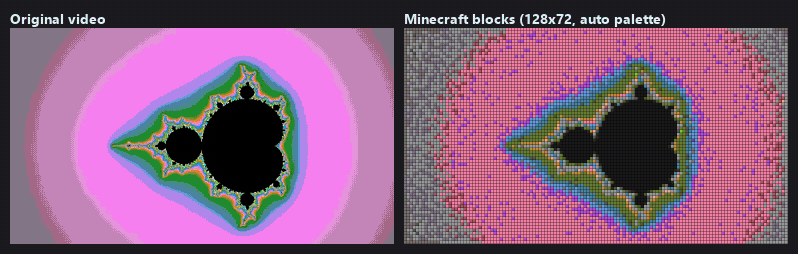
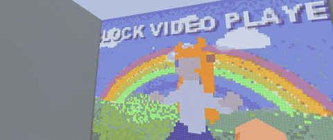

# Minecraft Bedrock Video Player

<!-- 言語の切り替え (README の各言語で同じ。tests/test_readme_languages.py) -->

  <b>English</b> ·
  <a href="README.zh-CN.md">简体中文</a> ·
  <a href="README.zh-TW.md">繁體中文</a> ·
  <a href="README.md">日本語</a> ·
  <a href="README.ko.md">한국어</a> ·
  <a href="README.de.md">Deutsch</a> ·
  <a href="README.fr.md">Français</a> ·
  <a href="README.es.md">Español</a> ·
  <a href="README.pt-BR.md">Português</a> ·
  <a href="README.ru.md">Русский</a>

Turn a video (MP4 and more) into real Minecraft blocks and play it in Minecraft Bedrock Edition with sound. Pick a video, press one button, and import the `.mcaddon`.

  
   
  Left: source / Right: converted to 128×72 blocks (rebuilt with the in-game rules)

  
   
  <b>View-dependent trompe-l'oeil</b> (real in-game recording): the dancer is painted on the floor and walls exactly as your eye sees it and repainted as you walk, so it looks like it is standing there

> This whole project (converter, add-on scripts, GUI and this README) was designed and written by AI.

## Features

- 🧱 **Real blocks**: up to 221 kinds (concrete, terracotta, wool, wood, logs, stone, ores…). Colours are measured from the game textures, and each scene picks up to 127 colours automatically.
- 🔊 **Sound that stays in sync**, even after pause and seek.
- 🧊 **3D holograms** you can walk around: relief, extruded or rounded figures, and MagicaVoxel (`.vox`) animations.
- 🪄 **Trompe-l'oeil**: a figure painted for your eye that looks solid from wherever you stand (correct for one viewer).
- 🧭 **Remote control** with a compass: play, pause, stop, seek, volume, next/previous video, video list.
- 📚 Several videos in one add-on, and an optional flat version of a 3D video in the same add-on.
- 🔓 **No cheats and no experimental features** needed (stable Script API only).
- 🌐 **10 languages**: messages and the remote follow each player's game language.
- 🖼 **Image mode (experimental)**: a separate add-on that shows the video as textures at up to 30 fps.

## Quick start

**A. Try the sample (no conversion, about 3 minutes)**
1. Download `BlockVideoPlayer-sample-….mcaddon` (flat) or `BlockVideoPlayer-sample-3d-….mcaddon` (3D) from the [latest release](https://github.com/ntk758/MinecraftAddon_Bedrock_Video-Player/releases/latest) and open it to import it into Minecraft.
2. In the world settings, turn on **both** the behavior pack and the resource pack (same name). Cheats can stay off.
3. Go to flat open ground (the screen **replaces the blocks there**, so use a test world). Face where you want the screen and run `/badapple:setup wall`, then `/badapple:start`.
4. Use a compass to open the remote. When you first join a world without a screen, a short message in chat tells you these steps.

**B. Convert your own video in the browser (no install, beta)**
- Open the [web converter](https://ntk758.github.io/MinecraftAddon_Bedrock_Video-Player/), pick videos and press *Create .mcaddon*. Works on Windows, Mac, Chromebook and phones; your videos never leave the browser.
- Pictures, camera clips, `.vox` and MMD models with a dance (`.pmx` + `.vmd`) work too. After building you can preview how it will look in Minecraft.
- For **Minecraft 1.21.80 to 1.26.0**, choose that under *Minecraft version* (those add-ons need cheats and use `/scriptevent` commands).

**C. Convert on Windows (faster, smaller add-ons)**
1. Unzip `BlockVideoPlayer-…-windows-x64.zip` from the [latest release](https://github.com/ntk758/MinecraftAddon_Bedrock_Video-Player/releases/latest) and run `BlockVideoPlayer.exe` (no Python needed). **FFmpeg is needed separately**: run `winget install Gyan.FFmpeg` or put `ffmpeg.exe` next to the EXE.
2. The getting-started guide opens the first time: it checks your PC, suggests settings and shows the commands to play. Without it: *Add video* → *Match video aspect ratio* → *Create .mcaddon*.
3. If the **playback load estimate** says *heavy*, lower the width, height or fps.

## Commands

`badapple` is the command prefix (you choose it when converting). Operators can use the commands; with cheats on, the older `/scriptevent badapple:…` form also works.

| Command | What it does |
|---|---|
| `/badapple:setup` | Place the screen here, flat on the floor (3D: stands 2 blocks north) |
| `/badapple:setup wall` | Stand a flat screen up like a TV, 3 blocks in front of you |
| `/badapple:setup face` | Lay it flat but facing the way you look |
| `/badapple:start` | Play the selected video from the start |
| `/badapple:play <ID>` / `/badapple:list` | Play a video / list the videos |
| `/badapple:remote` | Open the remote (same as a compass) |
| `/badapple:stop` | Stop and clear the screen |
| `/badapple:stats` | Real fps, TPS and late frames of the last playback |

## Image mode (experimental)

Tick *Also build the image-mode add-on* in the Windows app or the web converter (or run `python convert_image_mode.py video.mp4`). You get a second file, `<name>_image.mcaddon`. In game: `/badapple_img:setup`, then `/badapple_img:start`. It plays at up to 30 fps without replacing blocks, but uses texture memory, so keep it short. **Not tested in real Minecraft yet.** Details: [docs/IMAGE_MODE.md](docs/IMAGE_MODE.md).

## Requirements

| | |
|---|---|
| Minecraft | Bedrock Edition **1.26.10 or newer** (1.21.80–1.26.0: make it in the web converter) |
| Converter | Windows 10/11 EXE, or any modern browser. From source: Python 3.12 + FFmpeg (Linux works for the command line) |
| GPU (optional) | NVIDIA (CUDA), AMD (ROCm / DirectML) or Intel (DirectML); the CPU works too |

Tested on one Windows 11 PC. Phones, consoles and servers are expected to work but are **not tested yet** ([compatibility](docs/COMPATIBILITY.md)).

## FAQ

- **Java Edition?** No, Bedrock only.
- **No sound?** Turn on both packs, check the volume in the remote and the game, and restart Minecraft after importing.
- **Lag?** Lower the size or fps and check `/badapple:stats`. More in [known issues](docs/KNOWN_ISSUES.md).
- **Your own videos**: sharing an add-on made from someone else's video (anime, music videos, streams) can break copyright. Share only videos you made or are allowed to share.

## More

- [Changelog](CHANGELOG.md) · [Known issues](docs/KNOWN_ISSUES.md) · [Performance](docs/PERFORMANCE.md) · [Report a problem](https://github.com/ntk758/MinecraftAddon_Bedrock_Video-Player/issues/new/choose)
- The full documentation (Python setup, GPU, 3D modes, development, benchmarks) is in the [Japanese README](README.md).
- Inspired by [umbreonben/mc-cushion-bad-apple](https://github.com/umbreonben/mc-cushion-bad-apple). Video processing by FFmpeg. Unofficial fan project, not affiliated with Mojang Studios or Microsoft.
- License: [MIT](LICENSE)
