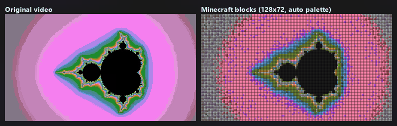
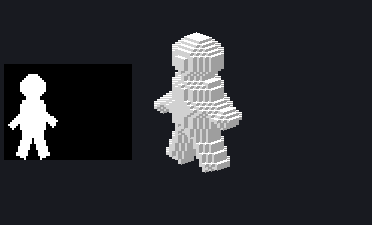
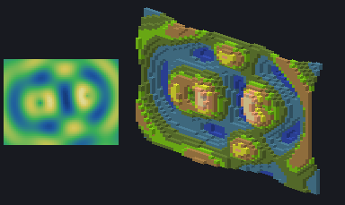

# Minecraft Bedrock Video Player

[](LICENSE)
[](https://www.python.org/)
[](https://www.minecraft.net/)
[](#-releases)
[](https://github.com/ntk758/MinecraftAddon_Bedrock_Video-Player/actions/workflows/ci.yml)
[](#)

<p align="center">
  
  <br>
  <sub>左: 元映像 / 右: 128×72 ブロックに変換した映像 (ゲーム内と同じ規則で復元した画面) — Left: source / Right: converted to blocks</sub>
  <br><br>
  
  
  <br>
  <sub>3D ホログラム (inflate / relief)。変換したデータをゲーム内と同じ規則で組み立て、斜め上から描いた絵 — 3D holograms rebuilt with the in-game rules</sub>
</p>

**▶ すぐ試す / Try it now:** [リリースページ](https://github.com/ntk758/MinecraftAddon_Bedrock_Video-Player/releases/latest) から `BlockVideoPlayer-sample-v6.4.0.mcaddon` (サンプル映像入り) や `BlockVideoPlayer-sample-3d-v6.4.0.mcaddon` (3D ホログラムのサンプル) をダウンロードしてインポートするだけで再生できます。自分の動画を変換するときは Windows 用の `BlockVideoPlayer-v6.4.0-windows-x64.zip` (Python 不要) を使ってください。
Download the sample add-on or the Windows app (no Python needed) from the [latest release](https://github.com/ntk758/MinecraftAddon_Bedrock_Video-Player/releases/latest).

[日本語](#日本語-japanese) | [English](#english) | [変更履歴 / Changelog](CHANGELOG.md)

## 🚀 クイックスタート / Quick start

**A. サンプルを試す (変換は不要・約 3 分) / Try the sample (no conversion)**
1. [最新リリース](https://github.com/ntk758/MinecraftAddon_Bedrock_Video-Player/releases/latest) から `BlockVideoPlayer-sample-v6.4.0.mcaddon` (平面) か `BlockVideoPlayer-sample-3d-v6.4.0.mcaddon` (3D) をダウンロードし、ダブルクリックで Minecraft (統合版) にインポートします。
   Download a sample `.mcaddon` from the [latest release](https://github.com/ntk758/MinecraftAddon_Bedrock_Video-Player/releases/latest) and double-click it to import it into Minecraft Bedrock.
2. 新しいワールドを作り、**チートを有効**、**ビヘイビアーパックとリソースパックの両方** を有効にします (スーパーフラットがおすすめ)。
   Create a world with **cheats on** and **both** the Behavior Pack and the Resource Pack enabled (a superflat world works best).
3. 平らな場所でチャットに `/scriptevent badapple:setup` → `/scriptevent badapple:start`。コンパスを使うとリモコンが開きます。
   Run `/scriptevent badapple:setup` then `/scriptevent badapple:start`. Use a compass to open the remote control.

**B. 自分の動画を変換する (Windows) / Convert your own video (Windows)**
1. [最新リリース](https://github.com/ntk758/MinecraftAddon_Bedrock_Video-Player/releases/latest) の `BlockVideoPlayer-v6.4.0-windows-x64.zip` を解凍し、`BlockVideoPlayer.exe` を起動します (Python は不要)。**FFmpeg は別に必要** です: `winget install Gyan.FFmpeg` を実行するか、`ffmpeg.exe` を EXE と同じフォルダに置きます。
   Unzip `BlockVideoPlayer-v6.4.0-windows-x64.zip` and run `BlockVideoPlayer.exe` (no Python needed). **FFmpeg is required separately**: run `winget install Gyan.FFmpeg` or put `ffmpeg.exe` next to the EXE.
2. 「動画を追加」→「動画の縦横比に合わせる」→「.mcaddon を作成」。画面の **再生負荷の目安** が「重い」なら幅・高さ・fps を下げます。
   Add a video → *Match video aspect ratio* → *Create .mcaddon*. If the **playback load estimate** says *heavy*, lower the size or fps.
3. できた `.mcaddon` を A の 2〜3 と同じように使います。うまくいかないときは [既知の問題](docs/KNOWN_ISSUES.md) を見てください。
   Use the result like steps A-2 and A-3. See [known issues](docs/KNOWN_ISSUES.md) if something goes wrong.

Python で動かす方法・GPU の設定は [インストールと使い方](#-インストールと使い方-installation--usage) にあります / To run from Python, see [Usage](#-usage).

### 対応環境 / Supported environments

| | 状態 / Status |
|---|---|
| Minecraft 統合版 Windows 11 | ✅ 作者の PC 1 台で確認 (アドオン v6.0.0、Minecraft の版は未記録) / tested on one PC |
| Windows 10・Android・iOS・Xbox・PlayStation・Switch・BDS・Realms | ⚠️ 未確認 (安定版 API だけなので動く想定。必要な版は 1.21.80 以降) / not tested yet (stable APIs only; needs 1.21.80+) |
| 変換ツール: Windows 11 EXE / Python 3.12 | ✅ 作者の PC で確認 (CPU・AMD DirectML) / tested on one PC (CPU, AMD DirectML) |
| 変換ツール: Linux (CLI) | 🧪 CI で毎回テスト / tested in CI |
| Java 版 / Java Edition | ❌ 非対応 / not supported |

詳しくは [docs/COMPATIBILITY.md](docs/COMPATIBILITY.md)、テストの範囲は [docs/TESTING.md](docs/TESTING.md) / Details: [compatibility](docs/COMPATIBILITY.md), [test scope](docs/TESTING.md).

### ダウンロードの確認 (SHA-256) / Verify your download
リリースページでは各ファイルの横に SHA-256 が表示されます (`SHA256SUMS.txt` が付いている版はそのファイルにも)。手元のファイルの値と一致すれば、壊れても書き換えられてもいません。
Each file on the release page shows its SHA-256; it must match the value you compute:
```powershell
Get-FileHash .\BlockVideoPlayer-v6.4.0-windows-x64.zip -Algorithm SHA256
```
```bash
sha256sum BlockVideoPlayer-v6.4.0-windows-x64.zip
```

## 日本語 (Japanese)

### 📖 概要 (Overview)
> **⚠️ 重要事項 (Important Note):**
> このプロジェクトは、コアアルゴリズム設計からPythonスクリプト、Bedrock Script API、GUIアプリケーション、最適化ロジック、そしてこのREADMEに至るまで、**すべて AI (Claude Opus / GPT / Gemini Pro等のエージェント) によって自律的に設計・プログラミング・構築されたものです**。

Minecraft Bedrock Edition（統合版）で、MP4 などの動画ファイルを「マイクラのブロック」へ変換し、ゲーム内で映像と音声を同期再生できるアドオン構築ツールです。GUI で動画を選んでボタンを押すだけで、そのままインポートできる `.mcaddon` を作成します。

### ✨ 特徴 (Features)
- 🎬 **MP4 等の動画から直接ブロック動画アドオンを生成** (映像は Behavior Pack、音声は Resource Pack)
- 🎵 **音声の同期再生** (10 秒単位の OGG に分割し、再生位置に合わせて切り替え)
- 🎮 **ゲーム内リモコン** (コンパスを使うと再生・一時停止・シーク・音量・動画切替の画面が開く)
- 📚 **マルチ動画対応** (1 つのアドオンに複数の動画を収録)
- 👑 **マイクラ実在ブロック 108 色** (コンクリート・テラコッタ・羊毛・木材・石・レンガ・光るブロックなど。重力で落ちず、時間で変化せず、掘っても資源にならないブロックだけ) から、シーンごとに最大 64 色を選ぶ自動パレット (既定、光るブロックは除く)。色は公式テクスチャの実測の平均色で、v6.4.0 の既定より色差 (ΔE2000) が 18〜62% 小さい ([比較](docs/research/palette_space.md))
- 🗜 **予測圧縮 (Phase 7.x)**: 変化したブロックだけを送る差分に、**動き補償** (平面は 8×8 ブロック、立体は 8×8×8 ブリック)・**タイル辞書** (一度出た模様を番号で再利用)・ランの位置の間隔符号化を組み合わせ、フレームごとに一番小さい方法を自動で選択。v5.4.0 よりデータ量が **47〜88% 減** (ディザなし。Blue Noise では約 43〜67% 減、[計測結果](#-ベンチマーク-phase-7x))。シーンごとのキーフレームで高速シーク
- 🧊 **3D ホログラム再生**: 映像を立体 (明るさを奥行きにした **レリーフ**・明るい部分の **押し出し**・丸く **ふくらませた** 立体) にして再生。MagicaVoxel (`.vox`) の立体アニメもそのまま再生。レリーフ・押し出し・ふくらみは「色 + 高さ (厚み)」の 2 枚の 2D 映像で送ってゲーム内で組み立てるので、立体のデータが 54〜85% 小さい
- 🧱 **まとめ置き描画**: 同じ色の変化を箱 (`fillBlocks`) や色ごとの座標リストにまとめて置き、API 呼び出しを 1 フレーム数百〜千回 → **数回〜数百回** に。キーフレームでも変わったブロックだけを置き直す。実機で置き方の速さを計る `bench` と、再生の実効 fps・遅れたフレーム・映像の遅れを表示する `stats` コマンド付き ([性能](docs/PERFORMANCE.md))
- 🎯 **かんたん設定**: 動画の縦横比に合わせた幅・高さをボタン 1 つで設定 (黒帯なし)、作る前に再生負荷の目安を表示、設定の誤りは項目ごとに説明
- ⚡ **GPU 変換対応**: NVIDIA (CUDA)・AMD (ROCm / DirectML)・Intel (DirectML)。GPU が無くても CPU で変換可能
- 🌐 **10 言語対応**: 日本語・English・简体中文・繁體中文・한국어・Español・Português (Brasil)・Français・Deutsch・Русский。GUI は画面右上で切り替え、ゲーム内のメッセージとリモコン画面は各プレイヤーの Minecraft の言語設定で表示

### 💻 必要な環境 (Requirements)
| 項目 | 内容 |
|---|---|
| OS | Windows 10 / 11 (変換ツール)。Linux でもコマンドラインで変換可能 |
| Minecraft | Bedrock Edition 最新版 (安定版 Script API `@minecraft/server` 1.19.0 / `@minecraft/server-ui` 1.2.0 を使用。**ベータ API は不要**) |
| Python | **3.12** (3.13 でも CPU 変換は動きますが、AMD GPU 用の DirectML は 3.12 までの対応です) |
| FFmpeg | PATH に通すか、`video_player_gui.py` と同じフォルダに `ffmpeg.exe` を置く |
| GPU (任意) | NVIDIA / AMD / Intel。PyTorch の追加が必要 ([GPU の設定](#4-gpu-の設定-任意)) |

### 🚀 インストールと使い方 (Installation & Usage)

#### 1. Python のインストール
- **Microsoft Store**: [Python 3.12 をインストール](https://apps.microsoft.com/detail/9ncvdn91xzqp) (推奨・最も簡単です)
- **公式サイト**: [Python.org](https://www.python.org/downloads/windows/) から 3.12 のインストーラーをダウンロード (「Add Python to PATH」に必ずチェック)

#### 2. FFmpeg のインストール
- **winget を使う場合**: コマンドプロンプトまたは PowerShell で次を実行し、ターミナルを開き直します。
  ```bash
  winget install Gyan.FFmpeg
  ```
- **手動インストール**: [FFmpeg 公式サイト](https://ffmpeg.org/download.html) から Windows 向けビルド (gyan.dev 等) を入手し、`ffmpeg.exe` をこのツールのフォルダに置くか PATH に追加します。

#### 3. ツールのセットアップ
このリポジトリをダウンロード (ZIP を解凍、または `git clone`) し、フォルダ内で必要なパッケージをインストールします。
```bash
pip install -r requirements.txt
```

#### 4. GPU の設定 (任意)
GPU を使わない場合はこの手順は不要です。

| GPU | OS | インストール方法 |
|---|---|---|
| NVIDIA | Windows / Linux | [PyTorch 公式サイト](https://pytorch.org/get-started/locally/) の CUDA 版 `torch` |
| AMD Radeon | Windows | `pip install -r requirements-directml.txt` (DirectML) または AMD 公式の ROCm 版 PyTorch for Windows (対応 GPU は AMD のドキュメントを参照) |
| AMD Radeon | Linux | [PyTorch 公式サイト](https://pytorch.org/get-started/locally/) の ROCm 版 `torch` |
| Intel Arc / 内蔵 GPU | Windows | `pip install -r requirements-directml.txt` (DirectML) |

- GUI の「変換デバイス」が **自動** なら **CUDA / ROCm → DirectML → CPU** の順に使えるものを選びます。DirectML では内蔵 GPU より単体 GPU を優先します。
- 変換前に GPU で小さなテスト変換を行い、失敗した場合は自動で CPU 変換に切り替えます。
- 実際に使われたデバイスは処理ログの `[MVCodec] 減色デバイス: AMD Radeon RX 9070 XT (directml)` (英語表示では `Conversion device:`) のような行で確認できます。
- GPU 経路は OkLab 色空間での色合わせ・知覚的なレート歪み最適化 (RDO)・時間方向ディザを行うため、CPU 経路 (Pillow) とは仕上がりが異なり、容量は小さめになります。処理が重い分、**変換全体が CPU より速くなるとは限りません** (例: RX 9070 XT + DirectML、256×256 で減色処理は約 200 fps)。
- GPU で処理できるディザは「なし / Blue Noise / Ordered」です。それ以外のディザを選ぶと CPU で処理されます。

#### 5. GUI で .mcaddon を作成
```bash
python video_player_gui.py
```
画面右上の **🌐 言語 (Language)** で表示言語を切り替えられます。初回は Windows の表示言語に合わせて選ばれ、選んだ言語は次回以降も使われます (入力中の内容はそのまま引き継がれます)。

1. **動画リスト**: 「動画を追加」で動画を選びます (複数可)。「ID編集」で動画 ID (英小文字・数字・`_`)、「サムネ秒編集」でアイコンに使う場面を変更できます。
2. **出力 .mcaddon**: 保存先を指定します。
3. **パック名・実行コマンド**: パック表示名と、ゲーム内コマンドの接頭辞 (既定 `badapple`) を設定します。**ゲーム内の言語** は、各プレイヤーのゲーム言語で表示する (10 言語、既定) か、この画面の言語に固定する (全員がその言語で表示され、言語ファイルが 1 つになるのでパックが約 20 KB 軽くなる) かを選べます。
4. **変換・再生設定**:

   | 設定 | 説明 |
   |---|---|
   | 画質プリセット | 幅・高さ・FPS をまとめて設定します (下表) |
   | 幅 / 高さ | スクリーンのブロック数 (最大 512) |
   | FPS | スライダーで 1〜20 fps を選びます (Minecraft は 1 秒 20 tick なので 20 が上限。20・10・5・4・2・1 のように 20 を割り切れる値だと一定の間隔で表示されます) |
   | キーフレーム間隔 | 何フレームごとに全画面を描き直すか (シークの速さに影響)。0 ならシーンの先頭のみ |
   | パレット | 自動 (おすすめ・既定: 101 色の候補からシーンごとに最大 64 色) / 全ブロック 108 色 (光るブロックを含む) / 39 色 / 拡張 33 色 / 基本 16 色。色を増やすと画質は上がり、データと置き替えるブロックは増えます |
   | ディザリング | なし / Blue Noise / Ordered (GPU 対応)、Floyd-Steinberg / Atkinson / Burkes / Sierra Lite (CPU のみ) |
   | 知覚最適化 | 輪郭部分だけにディザをかけて、平坦部のちらつきを抑えます |
   | 変換デバイス | 自動 / NVIDIA CUDA・AMD ROCm / DirectML / CPU のみ |

   | 画質プリセット | 解像度 | fps | 目安 |
   |---|---|---|---|
   | 軽量 | 64×64 | 20 | 動きの多い動画・低スペック向け |
   | 標準 | 96×96 | 10 | |
   | 高画質 (既定) | 128×128 | 10 | |
   | 高精細 | 128×128 | 5 | |
   | ウルトラ | 256×256 | 5 | 重い。PC 版推奨 |
   | 極限 | 512×512 | 2 | 非常に重い。PC 版推奨 |
5. **「.mcaddon を作成」** を押すと、処理ログに進行状況が表示され、完了するとダイアログが出ます。

#### 6. Minecraft で再生
1. 作成した `.mcaddon` をダブルクリックしてインポートします。
2. ワールドの設定で **ビヘイビアーパック** と **リソースパック** の両方を有効にします (同じパック名で 2 つあります)。`/scriptevent` を使うため **チートを有効** にしてください。
3. スクリーンを置きたい場所に立ち、次のコマンドを実行します (`badapple` は GUI で設定した接頭辞)。
   ```
   /scriptevent badapple:setup
   ```
   スクリーンは **プレイヤーの足元の高さに、東 (+X) と北 (-Z) 方向へ水平に** 作られます。範囲内のブロックは上書きされるので、平らで何もない場所で実行し、上空から見下ろしてください。
4. **コンパスを使う** (右クリック / 長押し) とリモコンが開きます。

| リモコンのボタン | 動作 |
|---|---|
| ▶ 再生 / 再開・⏸ 一時停止 | 一時停止やシークした位置から再開します |
| ⏹ 停止 ＆ クリア | 再生を止め、スクリーンを単色 (パレットの先頭のブロック) で塗りつぶします。立体 (relief / extrude / inflate / vox) は範囲を空気にして消します |
| ⏭ 次の動画・⏮ 前の動画・📜 動画リスト | 再生する動画を切り替えます |
| 🔊 音量設定 | 0〜100% |
| ⏩ シーク | 秒数を指定して移動します (移動後は一時停止) |

| コマンド | 動作 |
|---|---|
| `/scriptevent badapple:setup` | 現在地にスクリーンを設置 |
| `/scriptevent badapple:start` | 選択中の動画を最初から再生 |
| `/scriptevent badapple:list` | 収録動画の一覧 |
| `/scriptevent badapple:play <動画ID>` | 指定した動画を再生 |
| `/scriptevent badapple:gui` | リモコン画面を開く |
| `/scriptevent badapple:stop` | 停止してスクリーンを単色で塗りつぶす (立体は空気にして消す) |
| `/scriptevent badapple:render auto\|rect\|list\|block` | 描画方式を切り替える (既定 `auto`。下の「描画方式」を参照) |
| `/scriptevent badapple:bench` | スクリーンの範囲で置き方ごとの速さを計り、`auto` が使う費用 (1 回あたり・1 ブロックあたり) を求めてワールドに保存 |
| `/scriptevent badapple:stats` | 直前の再生 (再生中でも可) の計測結果を表示: 実効 fps・サーバーの TPS・映像の遅れ (実時間との差)・予定より遅れたフレーム・1 フレームのスクリプト時間 ([性能の測り方](docs/PERFORMANCE.md)) |

**描画方式**: `rect` は同じ色の変化を箱にまとめて `fillBlocks` で置き、`list` は色ごとの座標リストを `fillBlocks(ListBlockVolume)` で置き、`block` は 1 個ずつ置きます。既定の **`auto`** は、フレームごとに 3 つの方式の時間を見積もって一番速いものを選びます (細かい模様では座標リスト、大きな面や立体では箱になりやすい)。見積もりには「1 回の呼び出しの費用」と「1 ブロックの費用」を使い、初期値は Windows 版の実測値です。お使いの端末で `/scriptevent badapple:bench` を一度実行すると、その端末で測った値に置き換わります (ワールドに保存)。描画方式を固定したいときは `render rect` などで選べます。

#### 7. 3D ホログラム再生
<p align="center">
  
  
  <br>
  <sub>左: シルエットを丸くふくらませた立体 (<code>inflate</code>, 64×48×12) / 右: 明るさを奥行きにした立体レリーフ (<code>relief</code>, 64×48×16)。<br>どちらも変換したデータをゲーム内と同じ規則で復元し、斜め上から描いたもの (<code>scripts/preview_volume.py</code>)</sub>
</p>

GUI の **表示モード** で立体の作り方を選び、**奥行き (ブロック)** を指定して作成します。`.vox` を動画リストに追加すると MagicaVoxel の立体アニメになります (サムネイルは立体を斜め上から見た絵)。

| 表示モード | 内容 | 向いている映像 |
|---|---|---|
| 平面スクリーン | 従来どおり水平な画面 | すべて |
| 立体レリーフ (`relief`) | 明るいほど手前に飛び出す浮き彫り。表面と段差の側面だけを置く | 風景・CG・グラデーションの多い映像 |
| 立体シルエット (`extrude`) | 明るい部分を前後に押し出した板 | Bad Apple のような白黒映像 |
| 立体ふくらみ (`inflate`) | 明るい部分を、縁が丸く中央が厚い立体にふくらませる | 白黒のシルエット・ロゴ |
| MagicaVoxel (`vox`) | `.vox` のアニメーションの各フレームを 1 フレームとして再生 (シーンにある全オブジェクトは 1 つの立体にまとめる。シーングラフの無い古い `.vox` は各モデルが 1 フレーム) | ボクセルアート |

- `/scriptevent badapple:setup` を実行すると、立体は **プレイヤーの 2 ブロック北に、左右中央をそろえて足元から上へ** 立ちます。建築できる高さ (オーバーワールドは Y=319 まで) からはみ出す場合は下へずらしてお知らせします。南側 (プレイヤー側) から見るのが正面です。
- 奥行き・明るさの判定は減色前の元の映像の明るさを使うので、ディザをかけても表面が荒れません。`relief` は明るさが少し揺れただけでは奥行きを変えないので (ヒステリシス)、ちらつきと置き直しが減ります。
- 描画方式は既定の `auto` のままがおすすめです。立体の大きな面は箱で、細かい部分は座標リストで、フレームごとに速い方で置きます。
- 立体の表示モードを選ぶと、ディザは自動で「なし」になります (ディザの粒が表面の白い点々になるため)。必要なら自分で選び直せます。
- 変換結果は Minecraft を起動しなくても確認できます:
  ```bash
  python scripts/preview_volume.py out.js --output preview.gif --source-frames frames_dir
  ```

コマンドラインでの例:
```bash
# 明るさを奥行き 16 段にした立体レリーフ
python convert.py --input-video in.mp4 --output out.js --width 64 --height 48 --fps 10 --mode relief --depth 16
# 白黒映像の白い部分を丸くふくらませる (黒い部分なら --extrude-invert)
python convert.py --input-video badapple.mp4 --output out.js --width 64 --height 48 --mode inflate --depth 12
# MagicaVoxel の立体アニメ (アニメーションの各フレームが 1 フレーム。古い形式は各モデルが 1 フレーム。.vox が並んだフォルダも可)
python convert.py --input-vox anim.vox --output out.js --fps 10
```

#### スタンドアロン EXE (任意)
ビルド済みの EXE は [リリースページ](https://github.com/ntk758/MinecraftAddon_Bedrock_Video-Player/releases/latest) からダウンロードできます (DirectML 同梱)。自分でビルドする場合は PyInstaller を使います。DirectML (torch-directml) がビルド環境に入っていれば同梱されます。
```bash
pip install pyinstaller
python build_standalone.py
```
`dist/BlockVideoPlayer/BlockVideoPlayer.exe` ができます。同じフォルダに `ffmpeg.exe` を置くと PATH の設定が不要になります。

---

## English

### 📖 Overview
> **⚠️ Note:** This entire project—including the Python scripts, Minecraft add-on JavaScript, GUI application, and this README—was **fully designed, programmed, and generated by AI**.

A tool that converts video files (MP4, etc.) into Minecraft blocks and builds a `.mcaddon` that plays them in Minecraft Bedrock Edition with synchronized audio. Pick your videos in the GUI, press one button, and import the result.

### ✨ Features
- 🎬 **Video → block add-on** (video in the Behavior Pack, audio in the Resource Pack)
- 🎵 **Synchronized audio** (10-second OGG chunks switched by playback position)
- 🎮 **In-game remote control** (use a compass: play/pause, seek, volume, switch videos)
- 📚 **Multiple videos per add-on**
- 👑 **108 real block colors** (concrete, terracotta, wool, wood, stone, bricks, light blocks… — only blocks that don't fall, don't change over time and can't be farmed for resources) with a per-scene automatic palette of up to 64 colors (default, light blocks excluded). Colors are measured from the official textures: 18–62% lower color error (ΔE2000) than v6.4.0's default
- 🗜 **Predictive compression (Phase 7.x)**: on top of sending only changed blocks, each frame picks the smallest of **motion compensation** (8×8 blocks on screens, 8×8×8 bricks in 3D), a **tile dictionary** (patterns seen before are reused by number) and gap-coded run positions — **47–88% less data** than v5.4.0 without dithering (roughly 43–67% with Blue Noise; [benchmarks](#-ベンチマーク-phase-7x)); per-scene keyframes for fast seeking
- 🧊 **3D hologram playback**: turn a video into a volume (brightness-as-depth **relief**, **extruded** or rounded **inflated** silhouettes) or play MagicaVoxel (`.vox`) animations directly. Relief / extrude / inflate are sent as two 2D planes (colour + height/thickness) and rebuilt in-game, cutting 3D data by 54–85%
- 🧱 **Batched placement**: same-colour changes are placed as boxes (`fillBlocks`) or per-colour position lists, cutting API calls from hundreds–thousands per frame to **a few–a few hundred**; keyframes only re-place blocks that changed. `/scriptevent <prefix>:bench` measures the placement methods on your device and `:stats` reports playback fps, late frames and how far the video lags behind real time ([performance](docs/PERFORMANCE.md))
- 🎯 **Easy setup**: one click sets a width × height matching the video's aspect ratio (no black bars); the GUI shows a playback load estimate and explains invalid settings field by field
- ⚡ **GPU conversion** on NVIDIA (CUDA), AMD (ROCm / DirectML) and Intel (DirectML); CPU works too
- 🌐 **10 languages**: Japanese, English, Simplified/Traditional Chinese, Korean, Spanish, Portuguese (Brazil), French, German, Russian — in the GUI (selector at the top right) and in game (chat messages and the remote follow each player's Minecraft language)

### 💻 Requirements
- **OS**: Windows 10 / 11 for the GUI (the CLI also runs on Linux)
- **Minecraft**: latest Bedrock Edition (stable Script API `@minecraft/server` 1.19.0 / `@minecraft/server-ui` 1.2.0 — **Beta APIs are not required**)
- **Python**: 3.12 (3.13 works for CPU conversion, but DirectML supports up to 3.12)
- **FFmpeg**: on PATH or next to `video_player_gui.py`

### 🚀 Usage
1. `pip install -r requirements.txt`
2. Optional GPU: CUDA build of PyTorch (NVIDIA), ROCm build (AMD on Linux, or AMD's PyTorch for Windows), or `pip install -r requirements-directml.txt` (AMD / Intel on Windows). With **Device = Auto** the converter tries CUDA/ROCm → DirectML → CPU, runs a small self-test on the GPU and falls back to CPU if it fails. The log line `[MVCodec] Conversion device:` shows the device in use.
3. Run `python video_player_gui.py` (switch the UI language with **🌐 Language** at the top right — it follows your Windows display language by default), add videos, choose a quality preset / palette / dithering / device, and press **".mcaddon を作成"** (Create .mcaddon).
4. Import the `.mcaddon`, enable both the Behavior Pack and the Resource Pack, and turn on cheats (for `/scriptevent`).
5. Stand where the screen should be and run `/scriptevent badapple:setup` (`badapple` is the command prefix set in the GUI). The screen is built horizontally at your foot level, extending east (+X) and north (−Z); blocks in that area are overwritten.
6. Use a compass to open the remote control, or use `/scriptevent badapple:start | list | play <id> | gui | stop`.
7. **3D holograms**: choose a **Display mode** (relief / extrude / inflate) and a **Depth** in the GUI, or add a `.vox` file. `setup` builds the volume 2 blocks north of you, centred, from your feet upward (moved down if it would exceed the build height). The default `auto` render mode picks the fastest placement (boxes, per-colour position lists or one by one) for every frame from a cost model; run `/scriptevent badapple:bench` once to measure your device (saved in the world), or force a mode with `/scriptevent badapple:render rect|list|block`. 3D display modes switch dithering off by default. Preview any converted file without Minecraft: `python scripts/preview_volume.py out.js --output preview.gif`.

8. **Measuring performance**: the GUI shows a **playback load estimate** for the chosen size / fps, and *Match video aspect ratio* removes black bars (e.g. 1920×1080 → 128×72). After playing, `/scriptevent badapple:stats` prints the effective fps, server TPS, how far the video has fallen behind real time, late frames and script time per frame. See [docs/PERFORMANCE.md](docs/PERFORMANCE.md) for how conversion speed and in-game performance are measured.

### ❓ FAQ (English)
- **Java Edition?** No, Bedrock only.
- **Phones / consoles?** Expected to work (stable APIs only) but **not tested yet** — start with the Light or Standard preset and please report results in an issue.
- **Lag or video behind the audio?** Lower the size or fps; check `/scriptevent <prefix>:stats`. More in [known issues](docs/KNOWN_ISSUES.md).
- **GPU not used?** Check the `Conversion device:` log line; DirectML needs Python 3.12; CPU-only dithers run on the CPU.

A prebuilt Windows EXE (with DirectML) and a ready-to-play sample add-on are on the [latest release](https://github.com/ntk758/MinecraftAddon_Bedrock_Video-Player/releases/latest). To build the EXE yourself: `pip install pyinstaller` then `python build_standalone.py`.

---

## 📂 アーキテクチャとディレクトリ構成 (Architecture)

```text
.
├── video_player_gui.py        # GUI & pack builder (.mcaddon generator)
├── gui_i18n.py                # GUI translations loader, language detection, saved settings
├── locales/                   # Translations for the GUI, in-game texts (addon.*) and converter logs (convert.*); en.json is the reference
├── convert.py                 # Video → block data converter CLI (2-pass streaming, GPU/CPU)
├── mvcodec/                   # Codec library
│   ├── color.py               #   Palettes, dithering, OkLab
│   ├── auto_palette.py        #   Per-scene automatic palette (K-Means)
│   ├── device.py              #   GPU backend detection (CUDA / ROCm / DirectML)
│   ├── encode.py              #   RLE + VarInt encoder (gap-coded runs), 15-bit string packing
│   ├── motion.py              #   Motion estimation / compensation (2D blocks, 3D bricks)
│   ├── tiles.py               #   Implicit tile dictionary shared by encoder and decoders
│   ├── stream.py              #   Per-frame choice of delta / motion / tiles, GOP chunks and index
│   ├── volume.py              #   3D volumes: relief / extrude / inflate, MagicaVoxel .vox, isometric preview
│   └── decode.py              #   Python reference decoder (benchmark / tests)
├── main.js                    # In-game player (Bedrock Script API)
├── codec.js                   # Minecraft-independent decoder shared by main.js and Node tests
├── manifest.json              # Behavior Pack manifest template
├── pack_metadata.py           # Version and release notes
├── build_standalone.py        # PyInstaller build for the standalone EXE
├── benchmark/                 # Quality benchmark (PSNR, SSIM, ΔE2000, LPIPS) and codec_bench.py (size / API calls vs another revision)
├── scripts/                   # Utilities (demo GIF generator, preview_volume.py for 3D previews)
├── docs/images/               # README demo GIF and social preview image
├── tests/                     # pytest + Node round-trip tests
└── requirements*.txt          # Runtime / dev / benchmark / DirectML dependencies
```

データ形式やゲーム内の描画方式の詳細は [ARCHITECTURE.md](ARCHITECTURE.md) を参照してください。

## 🛠 技術スタック (Tech Stack)
- **Python 3.12**: 変換処理と GUI (Tkinter)
- **NumPy / Pillow**: 減色・ディザ (CPU)
- **PyTorch**: GPU 減色 (CUDA / ROCm / DirectML)
- **FFmpeg**: フレーム抽出・OGG 音声分割
- **Minecraft Script API**: `fillBlocks` (`BlockVolume` / `ListBlockVolume`) と `setBlockPermutation` によるブロック描画、`@minecraft/server-ui` のリモコン画面

## 🧪 開発者向け (Development)

- テストの範囲 (自動テストと実機テストの区別) とリリースごとの確認の記録: [docs/TESTING.md](docs/TESTING.md)
- リリースの手順 (チェックサムを含む): [docs/RELEASING.md](docs/RELEASING.md)
- 性能の測り方 (変換速度とゲーム内の再生性能): [docs/PERFORMANCE.md](docs/PERFORMANCE.md)
```bash
pip install -r requirements-dev.txt
pytest -q
```
- `tests/test_codec_v4.py` は変換結果を Python デコーダと `codec.js` (Node.js が必要) の両方で復元し、一致・シーク・パレット切替を検証します。
- `tests/test_motion.py` / `test_tiles.py` / `test_volume.py` / `test_volume3d.py` は動き補償・タイル辞書・立体 (3D 動き補償・inflate・ヒステリシス) を、Python と `codec.js` の一致・シークを含めて検証します。
- `tests/test_main_js.py` / `test_render_modes.py` は `main.js` をモックの Minecraft で動かし、置いたブロックが正しいこと、描画方式による違いが無いこと、変わったブロックだけを置くことを検証します。`tests/test_volume3d.py` は立体を 3D の箱でまとめて置くこと・建築限界内に収めることを、`tests/test_playback_control.py` はシーク中の再開・置けなかったマスのクリア・動画の切り替え・常時読み込みの後片付けを検証します。
- `tests/test_device.py` は GPU の選択と CPU へのフォールバックを検証します (PyTorch があれば GPU 用の処理も CPU で実行して確認)。
- GitHub Actions (`.github/workflows/ci.yml`) で push / PR ごとにテストと参考ベンチマークを実行します。

翻訳を追加・修正するには `locales/` の JSON を編集します。1 つのファイルに GUI (通常のキー)・ゲーム内の表示 (`addon.*`、引数は `%1` `%2`)・変換器のログ (`convert.*`) がまとまっています。
- 新しい言語は `en.json` をコピーして `<言語コード>.json` を作ると GUI の選択肢に現れます。ゲーム内でも使うには `gui_i18n.py` の `MINECRAFT_LOCALES` に Minecraft の言語コード (例: `it_IT`) を追加してください。
- ゲーム内の文字列は、GUI でビルドするときにリソースパックの `texts/*.lang` に書き出されます。翻訳が無い言語の Minecraft では英語 (`en_US`) で表示されます。「ゲーム内の言語」を固定にすると、GUI の言語の文章を `en_US.lang` だけに入れるので、どのゲーム言語のプレイヤーにもその言語で表示されます。
- `tests/test_i18n.py` がキーとプレースホルダーの過不足を、`tests/test_main_js.py` が `main.js` をモック環境で動かして、表示がすべて翻訳済みかを検査します。翻訳の改善 PR も歓迎です。

コマンドラインでの変換:
```bash
python convert.py --input-video in.mp4 --output out.js --width 128 --height 128 --fps 10 --palette auto --device auto
```

| 主なオプション | 説明 |
|---|---|
| `--input-video` / `--frames-dir` | 入力動画、または画像連番フォルダ |
| `--width` `--height` `--fps` `--duration` | 解像度・fps (最大 20)・変換する秒数 |
| `--palette` | `concrete` (16 色) / `expanded` (33 色) / `full` (39 色) / `all` (全ブロック 108 色) / `auto` (101 色からシーンごとに選ぶ。GUI の既定) |
| `--palette-colors` / `--palette-space` | `auto` で選ぶ色数の上限 (既定 64、候補は光るブロックを除く 101 色) / 色を選ぶ色空間 `rgb` (既定) か `oklab` ([比較](docs/research/palette_space.md)) |
| `--dither-method` | `none` / `blue_noise` / `ordered` / `floyd` / `atkinson` / `burkes` / `sierra` |
| `--device` | `auto` / `cuda` / `rocm` / `directml` / `cpu` |
| `--keyframe-interval` | キーフレーム間隔 (0 でシーン先頭のみ) |
| `--no-adaptive-fps` / `--no-perceptual` | 変化の少ないフレームの省略・知覚最適化を無効化 |
| `--no-motion` / `--mv-range` | 動き補償を無効化 / 局所探索の範囲 (既定 4、大きいほど速い動きに強いが変換が遅い。立体は ±2 固定) |
| `--tile-size` | タイル辞書のタイルの大きさ `auto` (既定: 4 と 8 の小さい方) / `4` / `8` / `16` / `0` (無効) |
| `--mode` | `screen` (既定) / `relief` / `extrude` / `inflate` / `vox` |
| `--input-vox` | MagicaVoxel の `.vox` (または `.vox` が並んだフォルダ)。`--mode vox` |
| `--depth` | 立体の奥行き (2〜128 ブロック、既定 16) |
| `--depth-video` | `relief` の奥行きに使うグレースケール動画 (明るいほど手前) |
| `--depth-hysteresis` | `relief` で奥行きを変えない揺れの幅 (段数、既定 1、0 で無効) |
| `--extrude-threshold` / `--extrude-invert` | `extrude` / `inflate` で立体にする明るさのしきい値 / 暗い部分を立体にする |
| `--thickness` | `extrude` の厚み (既定は奥行き全体) |
| `--hollow` | 外から見えない内部を置かない (既定は無効。`block` 描画方式で置く数を減らしたいとき用。有効にすると 2.5D の送り方は使えない) |
| `--volume-encoding` | `relief` / `extrude` / `inflate` の送り方。`planes` は色の平面と高さ (厚み) の平面の 2 枚で送りアドオンで立体に組み立てる (データが小さい)、`voxels` は立体をそのまま送る。既定の `auto` は送れるなら `planes` |
| `--temporal-hysteresis` | 条件付き更新のしきい値 (RGB の距離、既定 24、0 で無効)。前のフレームのブロックの色が、新しく選んだ色よりこの値以内しか悪くならなければ変えない (CPU で減色するとき。GPU の減色には同様の仕組みが入っている) |
| `--dither-follow-motion` | ディザ模様を映像の全体の動き (パン) に合わせてずらす (既定は無効。パンのデータは大きく減るが、置き直すブロックは増える) |
| `--ffmpeg` | ffmpeg のパス |

画質ベンチマーク:
```bash
pip install -r requirements-benchmark.txt
python benchmark/run.py --video in.mp4 --output out.js --fps 10
```

データ量と描画コストのベンチマーク (合成映像を作り、別の版と比べる。node と ffmpeg を使用):
```bash
python benchmark/codec_bench.py --out bench_out                  # 平面スクリーン (main と比較)
python benchmark/codec_bench.py --out bench_out --suite volume   # 立体
```

## 📊 ベンチマーク (Phase 7.x)

著作権の問題がない合成映像 5 種 (パン・アニメ風・白黒シルエット・ffmpeg の `testsrc2` / `mandelbrot`、各 60 フレーム、10 fps、39 色パレット) を `benchmark/codec_bench.py` で変換し、v5.4.0 (main) と比べました。描画コストは、モックの Minecraft で `main.js` を再生して数えた 1 フレームあたりの API 呼び出し回数です。

**データ量 (出力 .js、128×72) — v5.4.0 比**

| 映像 | ディザなし | Blue Noise | 呼び出し/フレーム (ディザなし): v5.4.0 → `rect` / `list` |
|---|---|---|---|
| パン (風景) | **−88%** (237 → 28 KB) | −43% | 1190 → 402 / **5.0** |
| アニメ風 (字幕・まばたき) | **−77%** (75 → 17 KB) | −64% | 513 → 107 / **8.8** |
| 白黒シルエット | **−75%** (73 → 18 KB) | −67% | 623 → 94 / **2.1** |
| testsrc2 | −62% | −58% | 1282 → 188 / **19.4** |
| mandelbrot | −47% | −57% | 762 → 424 / **23.3** |

- 256×144 でも −54〜88% (`.mcaddon` と同じ deflate 圧縮後は −58〜94%、Blue Noise の行を含む)。v5.4.0 は 100 チャンクを超える範囲の常時読み込みを登録できず、256×144 以上ではスクリーンを設置できませんでした (修正済み)。
- 置くブロックの数も減ります (キーフレームで全ブロックを置き直さない): アニメ風 513 → 365 / フレーム。
- Blue Noise は模様が画面に固定されるため動き補償が効きにくく、主な効果はラン位置の符号化とディザの決定化 (v5.4.0 はスレッド間で乱数を共有していたため、静止部分でもフレームごとに模様が変わっていた) によるものです。v5.4.0 の Blue Noise はスレッド間で乱数を共有していて出力が実行ごとに変わる (例: アニメ風 128×72 で 144〜308 KB) ため、Blue Noise の削減率は 1 回の計測による目安です。

**3D ホログラム (64×48×16、60 フレーム) — 3D 対応前 (2D 動き補償・中空・奥行きごとの長方形) との比較**

| 映像 / モード | データ量 | 呼び出し/フレーム `rect` | `list` |
|---|---|---|---|
| シルエット / `extrude` | 296 → 170 KB (**−42%**) | 1868 → **67** (−96%) | 2.4 |
| シルエット / `inflate` (新規) | 156 KB (動き補償なしなら 250 KB) | 743 | 2.3 |
| mandelbrot / `relief` | 195 → 167 KB (−15%) | 801 → 397 (−50%) | 21 |
| testsrc2 / `relief` | 25 → 26 KB | 47 → 22 (−54%) | 3.5 |

**2.5D パラメトリック立体 (Phase 8.3)** — 同じ映像を立体のボクセルのまま送った場合 (`--volume-encoding voxels`) との比較。省略するフレーム・置くブロック・呼び出しはまったく同じで、データだけが減ります (deflate 圧縮後):

| 映像 / モード | ボクセル | 2.5D | 削減 |
|---|---|---|---|
| シルエット / `extrude` | 54.8 KB | 8.5 KB | **−85%** |
| シルエット / `inflate` | 77.0 KB | 17.9 KB | **−77%** |
| mandelbrot / `relief` | 92.5 KB | 42.5 KB | −54% |
| testsrc2 / `relief` | 10.7 KB | 4.7 KB | −56% |

- アドオン側で立体に組み立てる処理は、変わった列 (relief は隣の段が変わった列も) だけなので、モックでの 1 フレームの処理時間は同じか少し短くなりました (rect で 0.8〜1.9 ms → 0.8〜1.5 ms)。

- 3D 動き補償: 12×12×12 の模様付きの箱が 1 マスずつ動く .vox では、差分フレーム 1 枚あたり **奥へ 108 → 23 B (−79%)**、**横 / 上下 180 → 23 B (−87%)** (2D の動き補償は奥行き方向の動きを予測できない)。
- `relief` の奥行きのヒステリシス (既定 1 段) は mandelbrot で データ −11%・呼び出し −19%、Blue Noise のパンで データ −34%。ディザなしのパンだけはデータが増えますが (23 → 41 KB)、置くブロックは −27%・呼び出しは −45% です。

設計・先行事例・計測の詳細は [docs/research/phase7x.md](docs/research/phase7x.md) を参照してください。

## ❓ よくある質問 (FAQ)

**Q. Java版で使えますか？ (Does this work on Java Edition?)**
A. いいえ、統合版 (Bedrock Edition) 専用です。

**Q. スマホやスイッチでも動きますか？ (Will it run on mobile/consoles?)**
A. 安定版の API だけを使っているので動く想定ですが、**まだ確かめていません** ([対応環境](docs/COMPATIBILITY.md))。軽量・標準プリセットから試してください。動いた・動かなかったを Issue で教えてもらえると助かります。

**Q. GPU があるのに CPU で変換されます。**
A. 処理ログの `[MVCodec]` の行を確認してください。PyTorch (または torch-directml) が入っていない場合や、GPU のテスト変換に失敗した場合は CPU になります。DirectML は Python 3.13 に対応していないため、Python 3.12 の環境に `requirements-directml.txt` を入れてください。Floyd-Steinberg などの CPU 専用ディザを選んでいる場合も CPU で処理されます。

**Q. 「ffmpeg が見つかりません」と表示されます。**
A. `ffmpeg -version` がターミナルで動くか確認してください。動かない場合は `ffmpeg.exe` をツール (または EXE) と同じフォルダに置いてください。

**Q. 再生が重い・カクつきます。**
A. 解像度を下げる (軽量・標準プリセット) か、fps を下げてください。1 tick あたりのブロック設置数には上限があり、超えた分は次の tick に持ち越されます。GUI の「再生負荷の目安」で作る前に目安が分かり、再生後に `/scriptevent badapple:stats` で実際の fps・遅れたフレーム・映像の遅れを確かめられます ([性能の測り方と目安](docs/PERFORMANCE.md))。

**Q. 作り直したアドオンを入れたら同じパックが 2 つ並びます / 更新されません。**
A. パック名とコマンド接頭辞が同じなら同じパック (同じ UUID) として作られ、バージョンはビルドごとに上がります。名前か接頭辞を変えると別のパックとして扱われます。

## 🗺 ロードマップ (Roadmap)
- [x] MP4対応 (Video format support)
- [x] GUI実装 (GUI Builder)
- [x] 音声同期再生 (Audio Sync)
- [x] GPU対応 (NVIDIA CUDA / AMD ROCm・DirectML / Intel DirectML)
- [x] マルチ動画パック対応 (Multi-video support)
- [x] **Phase 7: Research Edition**
  - オブジェクト指向JSエンジン (VideoPlayer クラスによるマルチスクリーン再生)
  - 局所的SSIMベースの知覚的RDO (エッジ・ディテール保存)
  - シーン適応型パレット & シーンGOP (0.5*SAD + 0.3*Hist + 0.2*Edge)
  - 統合ベンチマーク (SSIM, PSNR, LPIPS, ΔE2000)
- [x] **Phase 7.x: 次世代予測圧縮 (Next-Gen Prediction)** — `varint_rle_v5`
  - [x] Motion Vector Prediction (動き予測) — 8×8 ブロック、局所 ±4 + 縮小画像での全体探索。立体は 8×8×8 ブリックで (dx, dy, dz) ±2
  - [x] Tile Dictionary (タイル辞書圧縮) — エンコーダとデコーダが同じ規則で作る暗黙の辞書 (送らない)、新しい順の番号で参照、タイルの大きさ 4 / 8 を自動選択
  - [x] ラン位置の間隔符号化 (平面 128×72 で −27〜43%)、差分 / 動き / タイル / 両方 からフレームごとに最小を選択
  - [x] まとめ置き描画 (`fillBlocks` の箱・`ListBlockVolume`)、キーフレームで変わったブロックだけを置く、実機ベンチマーク (`bench`)
- [x] **3D立体ホログラム再生 (3D Hologram playback)** — `relief` (ヒステリシス付き) / `extrude` / `inflate` / MagicaVoxel `.vox` (シーングラフ・アニメーション対応)、3D の箱でまとめて設置、建築限界内への自動調整、等角投影のプレビュー
- [ ] **Phase 8: ワールド内レンダリングと知覚的な安定化 (In-World Rendering & Perceptual Stability)**
  - [x] **8.1 描画方式の自動選択**: `bench` で「1 回の呼び出しの費用」と「1 ブロックの費用」を分けて求めてワールドに保存し、描画方式 `auto` (既定) がフレームごとに「呼び出し回数 × 1 回の費用 + ブロック数 × 1 ブロックの費用」が最小の方式 (箱 / 座標リスト / 1 個ずつ) を選ぶ。初期値は実機 (Windows) の測定値: `fillBlocks` 1 回 15 µs + 1 ブロック 0.55 µs、1 個ずつ 2.3 µs、座標リスト 1 ブロック約 1.4 µs
  - [x] **8.2 ディザの時間的安定化**: 前のフレームのブロックの色が新しく選んだ色とほとんど変わらなければ変えない **条件付き更新** (`--temporal-hysteresis`、既定 24)。Blue Noise では v6.2.0 よりデータ −7〜48%・置くブロック −7〜51% (パン 949 → 470 / フレーム)、画質の低下はわずか。ディザ模様を全体の動きに合わせてずらす方式 (`--dither-follow-motion`) も実装したが、データは減っても置くブロックが 4.5 倍になるので既定では無効
  - [x] **8.3 2.5D パラメトリック立体**: `relief` / `extrude` / `inflate` を「色の平面 + 高さ (厚み) の平面」の 2 枚の 2D 映像として送り、アドオン側で変わった列だけを立体に組み立て直す (`--volume-encoding`、既定で有効)。2D の動き補償・タイル辞書がそのまま効き、置くブロック・呼び出しは同じままデータが **−54〜85%** (deflate 圧縮後)
  - [ ] **8.4 エントロピー符号化**: モード・位置・色を別々のストリームにして、GOP ごとの静的ハフマン (Smacker 型) か LZ (LZ4 型) をかける。xz では v5 のデータからさらに 22〜39% 縮むことを確認済み
  - [ ] **8.5 ブロックモードのレート歪み最適化**: 8×8 ごとに SKIP / 動き / 単色 / 2 色マスク / 辞書 / ラン を、データ量 + 呼び出しの費用 + 色差 で選ぶ (Smacker・RoQ 型)。タイルの 8 通りの回転・反転も参照できるようにする (調査では −3〜9%)
  - [ ] **8.6 構造物とクローンによる描画**: よく使うタイルを `StructureManager` の構造物にして 1 回で置く、Script API 2.x の `cloneBlocks` (2.10.0 以降) で動きベクトルのブロックを 1 回でコピーする (API の移行と機能の有無の確認が必要)
  - [ ] **8.7 ホログラムの素材と入力**: ステンドグラスや発光ブロックの半透明パレット、AI による単眼深度推定 (Video-Depth-Anything など) の深度動画を `--depth-video` に使う手順、サブチャンク (16 ブロック) にそろえた設置
  - [ ] **8.8 実映像での評価**: 権利上公開できる実映像のデータセットで、データ量・呼び出し回数・ゲーム内の tick 時間 (MSPT)・ちらつき (時間方向の変化率) を CI で継続計測

詳細は [TODO.md](TODO.md) を参照してください。

## 📝 謝辞 (Acknowledgments)
- Original Java Datapack idea inspired by [umbreonben/mc-cushion-bad-apple](https://github.com/umbreonben/mc-cushion-bad-apple).
- Video processing powered by **FFmpeg**.

## 🤝 コントリビュート (Contributing)
Issue や Pull Request はいつでも歓迎します！ 不具合・要望は [Issue のテンプレート](https://github.com/ntk758/MinecraftAddon_Bedrock_Video-Player/issues/new/choose) から送ると、必要な情報 (アドオンの版・Minecraft の版・端末) を書き漏らしません。
Feel free to open an Issue or submit a Pull Request! The [issue templates](https://github.com/ntk758/MinecraftAddon_Bedrock_Video-Player/issues/new/choose) ask for the versions and device we need.

- **いただいた声の扱い**: Issue・CurseForge のコメント・ダウンロード数は 2 週間に 1 回ほど確認し (`python scripts/traffic_report.py`)、不具合は [既知の問題](docs/KNOWN_ISSUES.md) へ、要望は [TODO.md](TODO.md) の優先度に反映します。実機での動作報告は [対応環境](docs/COMPATIBILITY.md) の表に追記します。
- **How feedback is used**: issues, CurseForge comments and download counts are reviewed about every two weeks; bugs go to the known-issues page, requests into TODO.md priorities, and device reports into the compatibility table.

## 📜 ライセンス (License)
This project is licensed under the [MIT License](LICENSE).

---

## 🏷 Releases

すべての版の変更点は [CHANGELOG.md](CHANGELOG.md) にあります / Full history: [CHANGELOG.md](CHANGELOG.md).


- **v6.4.0**: Phase 8.3 2.5D パラメトリック立体。レリーフ・押し出し・ふくらみを「色 + 高さ (厚み)」の 2 枚の 2D 映像で送り、ゲーム内で変わった列だけ組み立て直す (置くブロックは同じで立体のデータ 54〜85% 減)。GUI に「動画の縦横比に合わせる」ボタン・再生負荷の目安・項目ごとのエラー表示、ゲーム内の計測コマンド `stats`、MS-SSIM、自動パレットの色空間・色数のオプションを追加。クイックスタート・対応環境・性能の測り方・テストの記録などのドキュメントを整備。
- **v6.3.0**: Phase 8.2 ディザの時間的安定化。前のフレームのブロックの色が新しく選んだ色とほとんど変わらなければ置き直さない条件付き更新 (`--temporal-hysteresis`) で、Blue Noise ではデータ 7〜48%・置くブロック 7〜51% 減。ディザ模様を映像の動きに合わせてずらすオプション (`--dither-follow-motion`) も追加。
- **v6.2.0**: GUI の再生間隔 (tick) を FPS のスライダー (1〜20 fps) に変更。ゲーム内の言語を「各プレイヤーのゲーム言語 (10 言語)」か「GUI の言語に固定 (全員がその言語で表示、パックが約 20 KB 軽くなる)」から選べるように。
- **v6.1.0**: Phase 8.1 描画方式の自動選択。描画方式 `auto` (既定) がフレームごとに箱・座標リスト・1 個ずつのうち一番速い置き方を選ぶ (実機の測定値を使用。`bench` で自分の端末の値を測って保存できる)。立体の変換を約 4 倍高速化し、変換中の進み具合と残り時間をログに表示。GUI で立体の表示モードを選ぶとディザを自動で「なし」に。
- **v6.0.0**: Phase 7.x 次世代予測圧縮と 3D ホログラム。動き補償 (平面 8×8 / 立体 8×8×8)・暗黙のタイル辞書・ラン位置の間隔符号化で、v5.4.0 よりデータ量 47〜88% 減 (ディザなし)。映像を立体 (relief / extrude / inflate) にしたり MagicaVoxel の立体アニメを再生する 3D ホログラム再生。`fillBlocks` の箱・座標リストでまとめて置く描画 (`render` コマンドで切替) と実機ベンチマーク (`bench`)、キーフレームで変わったブロックだけを置く再生。v5.1.0〜v5.4.0 で作ったアドオンがインポートできなかった不具合 (manifest のバージョン番号) と、256×144 以上のスクリーンを設置できなかった不具合を修正。
- **v5.4.0**: ゲーム内表示の多言語対応。チャットのメッセージとリモコン画面が、各プレイヤーの Minecraft の言語設定 (10 言語、未対応の言語は英語) で表示されるように。変換器のログも GUI で選んだ言語で表示。`main.js` をモック環境で動かす結合テストを追加。
- **v5.3.0**: GUI の多言語対応。画面右上の「🌐 言語」で 10 言語 (日本語・English・简体中文・繁體中文・한국어・Español・Português (Brasil)・Français・Deutsch・Русский) に切り替え可能。初回は OS の表示言語を自動選択し、選んだ言語を保存。翻訳は `locales/*.json` で追加・修正できます。
- **v5.2.0**: AMD GPU 対応。ROCm 版 PyTorch (Linux / Windows) と DirectML (Windows の AMD / Intel GPU) で GPU 変換が可能に。GUI に「変換デバイス」選択を追加し、GPU の動作確認に失敗した場合は自動で CPU 変換へ切り替え。GUI からの変換が引数エラーで失敗していた v5.1.0 の不具合を修正。
- **v5.1.0**: 品質改善リリース。自動パレット使用時にシーン切替で色が崩れる問題 (GOP 先頭を必ずキーフレーム化)、横長動画・サムネイルが中央に配置されない問題、シーク後に再開できず先頭に戻る問題、別の動画を選んでも切り替わらない問題、EXE 版で変換できない問題を修正。再生速度を動画データの fps から決定、変換を 2 パスのストリーミング化してメモリ使用量を削減、盤面クリアの分割実行、再ビルド時もパック UUID を維持、CI でテストとベンチマークを実行するよう改善。
- **v5.0.0**: Phase 7 Research Edition。オブジェクト指向JSエンジンによるマルチスクリーン再生、SSIMベースの知覚的RDO、シーン適応型パレット＆GOPを導入。
- **v4.0.0**: Phase 6。OkLab知覚色空間への移行による色再現性の改善、シーン適応型の自動圧縮制御(RDO/ME)、NumPyベクトル化によるエンコード効率向上、予測型GOPプリフェッチとスマートティック予算による再生安定性の強化。
- **v3.2.0**: v4 GOP-Chunked 遅延デコードフォーマットを導入。GOP 単位の独立チャンク分割+LRUキャッシュにより、高解像度動画のワールド読み込み速度を改善。
- **v3.1.0**: Ultra-HD (512x512) 描画、バジェットベースRDO/MEによる負荷分散、v3バイナリ連結フォーマットによる高速ワールドロード、Temporal Dithering などを搭載。
- **v2.8.0**: Phase 4 MVCodec 導入。動的自動ブロックパレット生成 (K-Means)、Blue Noise ディザリングと知覚最適化フィルター、GUIへのベンチマーク表示機能を追加。
- **v2.7.0**: Zero-copy FFmpegパイプライン導入によるストリーミング対応、UTF-16バイナリエンコードによる容量削減、FFmpeg HWAccelのYUV破損バグを修正。
- **v2.6.4**: Script API での音声再生時、Bedrock 1.21以降の厳格な引数仕様(`location`)により音が鳴らない問題を修正。
- **v2.6.3**: `.mcaddon` 生成時に Script API の依存関係が消えてしまうバグを修正。
- **v2.6.2**: GUI起動時の変数初期化エラーを修正。
- **v2.6.1**: READMEの全面改修、GUIのディザリングGPU対応表記を最適化。
- **v2.6.0**: Ordered (Bayer) ディザリング時のGPUテンソル並列計算と、VRAMパンク(OOM)対策を実装。
- **v2.5.0**: 音声再生に完全対応。`.mcaddon` 形式へのアーキテクチャ刷新。
- **v2.1.0**: PyTorch GPU アクセラレーション統合。
- **v2.0.0**: 拡張パレット、ゲーム内リモコンGUI搭載。
