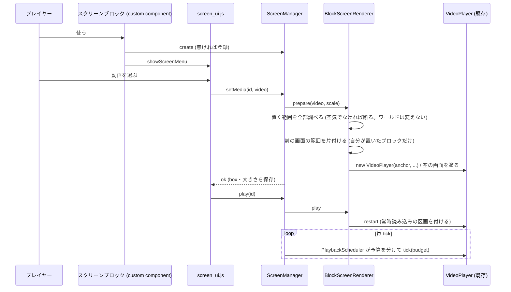

# スクリーンシステム (Screen System Foundation)

ブロックを置いて使うだけで動画を再生できる「スクリーンブロック」と、複数のスクリーンを独立して動かす土台の設計・使い方・制約です。
2026-11-19 に作りました (ブランチ `feat/screen-system-foundation`)。PC (Windows 11、Minecraft v26.65) の実機で、2 人での音以外の項目を確かめました ([TESTING.md の 7 の記録](TESTING.md))。2 人での音・スマートフォン・ゲーム機は、実機ではまだです。

## 1. 使い方 (ゲームの中)

1. クリエイティブのインベントリの「アイテム」の欄から **ビデオスクリーン** (`<接頭辞>:video_screen`) を取り出して置く。置いたときに見ていた方向に画面が向く。
2. ブロックを使う (PC は右クリック、スマートフォンは長押し、コントローラーは「使う」ボタン)。操作画面が開く。
3. 「動画を選ぶ」から動画を選ぶ。置く場所を調べて、ブロックの上に壁のように画面を立て (左右の中央がブロックの真上)、そのまま再生する。立体の動画は、手前の面をブロックの面にそろえて奥へ置く。
4. もう一度ブロックを使うと、再生・一時停止・停止・シーク・動画の切り替え・設定 (音量・ループ・大きさ)・削除ができる。
5. ブロックを壊すと、そのスクリーンが置いたブロックだけを片付けて登録を消す。操作画面の「スクリーンを削除」は画面だけを片付け、ブロックは残る (もう一度使うと新しいスクリーンになる)。

コマンドの入力はいりません (チートも不要)。従来のコマンド (`/<接頭辞>:setup` など) とコンパスのリモコンは、今までどおり 1 つの画面を動かします。スクリーンブロックとは別のもので、両方を同時に使えます。

## 2. 構成

| ファイル | 役割 |
|---|---|
| `screen_system.js` | 土台。Minecraft の API を import しない (Node で単体テストする)。`ScreenSession`・`ScreenRegistry`・`PlaybackScheduler`・`ScreenManager` |
| `main.js` (最後の `legacy:screens` の印の範囲) | ブロックモードのレンダラー (`BlockScreenRenderer`)、ブロックのイベント、保存の読み書き、操作画面とのつなぎ (`screenUi`) |
| `screen_ui.js` | 操作画面 (ActionFormData・ModalFormData)。スクリーンの操作は `ui` を通すだけで、描画方式を知らない |
| `pack_builder.py` | ブロックの定義 `BP/blocks/video_screen.json`、テクスチャ (`RP/textures/`)、ブロックの名前 (`tile.<接頭辞>:video_screen.name`)、BP の data モジュールを入れる |

### クラス

- **ScreenSession**: 1 つのスクリーンの状態。`screen_id`・`media_id`・`renderer_type` (描画方式: block / image)・`mount_type` (設置方式: block / 将来の projector)・`dimension`・`position`・`facing`・`playback_state` (idle / playing / paused / stopped)・`playback_position` (秒)・`volume`・`loop`・`scale`・`screen_width` / `screen_height` (ブロック)・`creation_time`。加えて、このスクリーンが置いたかもしれないブロックの範囲 (`box` と、片付け終わっていない前の範囲 `pendingClear`)。
- **ScreenRegistry**: ID と位置 (ディメンション + 座標) の表。同じ位置に 2 つ登録しない。ディメンションが違えば同じ座標でも別。上限は 16 個。
- **PlaybackScheduler**: `runInterval` は 1 つだけ。毎 tick、描くものがある画面 (コマンドの画面も含む) で 1 tick の予算 (30 ms・4000 ブロック) を分ける。1 つだけなら予算は全部 (以前と同じ)。順番は tick ごとにずらす。ある画面の描画が例外を投げても、ほかの画面は描き続ける。描くものが 100 tick 無ければタイマーを止める。
- **ScreenManager**: 登録・削除・取得・一覧・再生・一時停止・停止・シーク・動画の切り替え・音量・ループ・保存・復元。同時に再生できるのは 4 つまで。準備中・削除中のスクリーンへの操作は断る (`busy`)。描画方式ごとのレンダラーを `createRenderer` で作る。

### レンダラーの約束 (`RENDERER_CONTRACT`)

`prepare(mediaId, { scale })`・`play({ fromStart, position })`・`pause()`・`stop()`・`seek(seconds, { resume })`・`setVolume(v)`・`position()`・`duration()`・`isRunning()`・`wantsTick()`・`tick(budget)`・`release({ clearBlocks })`、それと `onFinished` (最後まで再生したらレンダラーが呼ぶ)。ScreenManager はこれ以外を呼ばないので、設置方式 (ブロック・プロジェクター) と描画方式 (ブロックモード・画像モード) は独立しています。

### データの流れ (動画を選んでから映るまで)

再生・シーク・GOP の展開・差分での描画・音声のチャンクは、コマンドの画面と同じ `VideoPlayer` を使います (動画の形式・圧縮・フレームの構造は変えていません)。`VideoPlayer` に足したのは、スクリーンごとの音量・音声・知らせ・終わりのつなぎ (`hooks`)、分けた予算 (`tick(budget)`)、拡大 (`scale`)、片付け (`dispose`) だけで、`hooks` が無いとき (コマンドの画面) は以前と同じ動きです。

## 3. 建物を壊さないために

- 画面を置く範囲は、置く前にすべて `getBlock` で調べます。空気でないブロックが 1 つでもあれば置かず、最初の位置と数を知らせます (ワールドは変えない)。世界の高さに入らない・読み込まれていない・ほかのスクリーンやコマンドの画面と重なる場合も同じです。
- 置いた範囲 (`box`) を、置く前に保存します。削除・動画の切り替え・大きさの変更では、その範囲の中の「このアドオンの動画のパレットのブロック」だけを空気に戻します。プレイヤーが後から置いたほかのブロック (チェストなど) は残ります。
- 読み込まれていなくて片付けられなかった範囲は、ワールドに保存し (`<接頭辞>:screen_orphans`)、ワールドを開いたときとスクリーンを使ったときに、読み込まれている所から片付けます。そのとき、今のスクリーンとコマンドの画面のマスには触りません。
- コマンドの `setup` も、スクリーンブロックの画面と重なる位置には置かなくなりました (以前からの動きは、重ならない限り変わりません)。

既知の限界: 画面の範囲の中に、プレイヤーがパレットと同じブロック (コンクリート・羊毛など) を置くと、画面のブロックと区別できないので片付けで消えます。再生中に画面の範囲へ置いたブロックは、次のフレームで上書きされます (画面の中なので)。

## 4. 保存と復元

- 1 つのスクリーンを 1 つの動的プロパティ (`<接頭辞>:screen.<ID>`) に JSON で、一覧と通し番号を `<接頭辞>:screens` に保存します。再生中は 2 秒ごとに位置を保存します。
- ワールドを開き直すと、再生中だったスクリーンは「一時停止」で戻ります (勝手に再生を始めない)。画面には閉じたときの場面が残っていて、再生すると保存した位置から続けます。
- 壊れた記録 (型・範囲が違う・同じ位置が 2 つなど) は捨てて、ほかの記録は使います。動画が作り直したアドオンから無くなっていれば、再生のときに知らせます (動画を選び直せる)。
- スクリーンブロックが無くなっていれば (爆発・`/setblock` などでイベントを取りこぼしても)、見回り (再生中は 5 秒ごと、スクリーンを使ったとき、ワールドを開いたとき) で片付けます。

## 5. 音声

スクリーンごとに音声のチャンクを持ち、止めるときはそのスクリーンが鳴らしている音だけを止めます (`stopsound @a <音の ID>`。ほかのスクリーンの音も、全員の音楽も止めない)。鳴らすのは、スクリーンの画面の中心から 48 ブロック以内にいるプレイヤーだけです (離れた所のスクリーンの音が重ならない)。距離での音量の減衰はまだありません (Phase 3)。

## 6. 制約と、実装しなかったもの

| 項目 | 状態 | 理由・代わり |
|---|---|---|
| 画像モードのスクリーンブロック | 未実装 | 画像モードは別のパック・別のスクリプト (`image_main.js`) で、状態が 1 画面ぶんのグローバル変数 (`state`) と 1 つのエンティティ。1 つのブロックから両方のスクリプトを操作する安定した手段 (同じパックの中の呼び出し) が無い。土台 (`screen_system.js`) は描画方式に依存しないので、画像モードのパックに同じ土台と `ImageScreenRenderer` (スクリーンごとのエンティティと時計) を入れるのが次の段階 |
| プロジェクター | 未実装 (Phase 4) | `MOUNT_TYPES.PROJECTOR` と、置き方を決める関数 (`screenLayoutFor`) を分けてある。投影の範囲と向きから同じ `box` を作れば、確かめ・片付け・保存はそのまま使える |
| URL からの取り込み | 未実装 (Phase 5) | ゲームの中では行わない (Windows 版・ブラウザ版の役目)。ゲーム内でのストリーミングは、標準の Script API にネットワークの機能が無いので対象外 |
| 複数人での同期 | 一部 | 再生の状態はサーバー (スクリプト) に 1 つなので全員が同じ画面を見る。距離での音量・人ごとの音量・操作の権限は Phase 3 |
| だまし絵の動画 | スクリーンブロックでは表示しない | 舞台 (床と壁) を見る人の位置に合わせて置く作りで、ブロックの上の壁には収まらない。コマンドの `setup` で置く |
| 大きさ (倍率) | 平面の動画だけ 1〜4 倍 (幅・高さ 256 ブロックまで、世界の高さに入る分) | 立体・古い形式は 1 倍だけ |

## 7. テスト

| 種類 | ファイル | 中身 |
|---|---|---|
| 単体 | `tests/js/screen_system_test.mjs` (`tests/test_screen_system.py` から実行) | 32 件。生成・削除・ID の一意・位置の重複 (ディメンション別)・状態の変化・シーク・保存と復元・壊れた記録・独立 (A を止めても B・C は変わらない)・同時再生の上限・準備中の操作・スケジューラーの予算の分け方・タイマーの解放・例外の切り離し |
| 結合 | `tests/test_screen_block.py` | 20 件。モックの Minecraft で main.js を動かす: 置く・使う・選ぶ・再生、4 方向、3 つのスクリーンの独立、建物の上に置かない、高さ・読み込みの不足、壊したときの片付け (自分のブロックだけ)、メニューからの削除、大きさの変更、ワールドの開き直し、コマンドの画面との重なりと同時再生、同時再生の上限、爆発とイベント無しの消失、準備中の破壊、壊れた保存・無くなった動画、音の範囲、スクリーンごとの音量とループ |
| パッケージ | `tests/test_screen_system.py` | ブロックの定義とコンポーネントの名前・テクスチャの参照先・PNG・翻訳の行・manifest の data モジュールと UUID の重複・2 つのアドオンで名前がぶつからない・旧版向けの出力にブロックが入らない・使っている文の鍵が翻訳にある |

実機で確かめること (Phase 6) は [TESTING.md](TESTING.md) の 7 章にあります。
