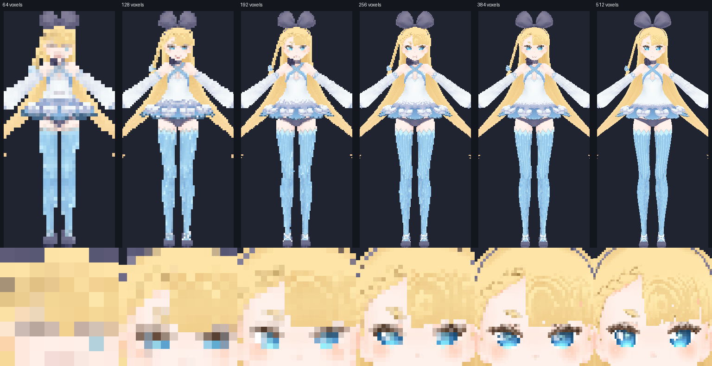

# MMD の 2 つの経路の計測 (PC、2026-11-23)

設計: [mmd_dual_path_design_2026-11.md](mmd_dual_path_design_2026-11.md)。**ここの数値はすべて PC の上の計測です。Minecraft の中の fps・読み込み時間・
メモリ・長く流したときの安定は、まだ測っていません (実機が要る)。**

- PC: Windows 11 Pro、Intel 24 コア 32 スレッド、RAM 31.7 GB、AMD Radeon RX 9070 XT、Python 3.13、numpy 2.4、FFmpeg 9.0.1。
- モデル: ニコニ立体ちゃん (Alicia Solid、頂点 22,311・面 31,866・材質 22・ボーン 約 200)。踊り: 同梱の「2分ループステップ1.vmd」。
  モデルと踊りの規約により、ここでは計測と確認にだけ使い、出来た物は配っていない。

## 1. Block Mode (骨で動かす人物) — `scripts/bench_mmd_figure.py`

10 秒の踊り、物理なし (物理は細かさに関係なく同じ時間がかかるので外した)、細かさごとに別のプロセス。
「人物を作る」は部品の板・シート・アニメーションまで。ピーク RAM はそのプロセスのピークのワーキングセット。

| ボクセル | 板の画素 | ボクセルにする (s) | 人物を作る (s) | 合計 (s) | ピーク RAM (MiB) | 表面のボクセル | シート | テクスチャ (MiB) | 板 | ボーン | geometry (KiB) | アニメーション (KiB) |
|---|---|---|---|---|---|---|---|---|---|---|---|---|
| 64 | 1 | 0.09 | 1.54 | 8.88 | 165.7 | 3,603 | 4094×28 | 0.44 | 950 | 52 | 91.1 | 172.7 |
| 128 | 1 | 0.15 | 1.75 | 9.21 | 187.3 | 15,103 | 4094×81 | 1.27 | 1,698 | 54 | 169.0 | 226.8 |
| 192 | 1 | 0.24 | 2.35 | 9.89 | 225.6 | 34,938 | 4095×191 | 2.98 | 2,426 | 56 | 235.5 | 254.8 |
| 256 | 1 | 0.35 | 3.24 | 10.92 | 275.6 | 63,496 | 4096×368 | 5.75 | 3,171 | 58 | 326.9 | 274.0 |
| 384 | 1 | 0.7 | 8.58 | 16.46 | 485.9 | 146,082 | 4096×1025 | 16.02 | 4,614 | 59 | 463.6 | 302.8 |
| 512 | 1 | 1.16 | 22.29 | 30.65 | 978.9 | 263,185 | 4096×2248 | 35.12 | 6,064 | 59 | 647.9 | 318.9 |
| 64 | 2 | 0.1 | 2.04 | 9.52 | 191.3 | 3,603 | 4092×66 | 1.03 | 950 | 52 | 92.0 | 172.7 |
| 128 | 2 | 0.17 | 2.83 | 10.36 | 278.0 | 15,103 | 4094×244 | 3.81 | 1,698 | 54 | 172.0 | 226.8 |
| 192 | 2 | 0.25 | 4.14 | 11.58 | 412.3 | 34,938 | 4096×626 | 9.78 | 2,426 | 56 | 237.7 | 254.8 |
| 256 | 2 | 0.38 | 6.48 | 14.23 | 563.0 | 63,496 | 4096×1280 | 20.0 | 3,171 | 58 | 330.6 | 274.0 |
| 384 | 2 | 0.72 | 15.58 | 23.57 | 1053.1 | 146,082 | 4096×3794 | 59.28 | 4,614 | 59 | 468.8 | 302.8 |
| 512 | 2 | 作れない: 板が 1 枚のシート (4096×4096) に入らない | | | | | | | | | | |

わかったこと:

- 合計の時間のうち約 7 秒は姿勢の計算 (細かさに関係ない)。人物を作る時間は 256 までゆっくり、384 から急に増える (384×2 で 16 秒、512×1 で 22 秒)。
- 板の数は細かさにほぼ比例 (同じ色の面をまとめるので、表面のボクセルの数ほどは増えない)。ボーンは 52〜59 本で、細かさでほとんど変わらない。
- テクスチャは「表面 × 板の画素²」で増える。512 は板の画素 2 だと人物のシート (1 枚、4096 まで) に入らないので、`extreme` は板の画素 1 にした。
  384×2 でも 59 MiB で、アドオンの予算 (Tier 2 225 MB) の 1/4 を使う。
- 見た目 (下の画像、初期姿勢の正面、板の画素 1 の色): 64 は顔が分からない。128 で目と口が分かり、256 で目の形、384 でまつげが出る。512 は 384 とほとんど変わらない。
  前髪の所で、384 以上は奥の髪の色が手前のボクセルに混ざって見える所がある (ボクセルの色の選び方の改善の候補)。

段 (`--figure-preset`) はこれで決めた: mobile 64×2 (テクスチャ 約 1 MiB)、standard 128×2 (約 4 MiB)、high 192×2 (約 10 MiB)、ultra 256×2 (約 20 MiB、今の既定と同じ人物)、
experimental 384×2 (約 59 MiB)、extreme 512×1 (約 35 MiB)。

## 2. Rendered Mode (描いた動画) — `scripts/bench_mmd_render.py`

10 秒、物理 standard、表情 (まばたき・口)、周りを回るカメラ、自作の曲。描くプロセスの数は CPU とメモリから自動 (`default_jobs`)。
「1 コマ」は 1 つのプロセスが 1 コマにかけた時間 (ほかのプロセスと同時に動いているときの値)。CPU はシステム全体の平均。
RAM は描くプロセス 1 つのピーク (親のプロセスは全段で約 340 MiB)。描き手は CPU だけで GPU のメモリは使わない (エンコードの h264_amf だけが GPU。VRAM は測っていない)。

| 段 | 大きさ | fps | 縦横の倍率 | コマ | 1 コマ (s) | 描く (s) | 姿勢 (s) | エンコード (s) | プロセス | CPU (%) | RAM (MiB) | MP4 (MiB) | PNG の合計 (MiB) | 音声のずれ (s) |
|---|---|---|---|---|---|---|---|---|---|---|---|---|---|---|
| mobile | 854×480 | 24 | 2 | 240 | 2.17 | 25.9 | 21.5 | 0.7 | 22 | 90 | 436 | 2.3 | 17 | 0.0 |
| standard | 1280×720 | 30 | 2 | 300 | 3.69 | 63.8 | 26.1 | 1.2 | 18 | 78 | 543 | 4.5 | 42 | 0.0 |
| high | 1920×1080 | 30 | 2 | 300 | 5.29 | 134.1 | 26.1 | 1.9 | 12 | 59 | 695 | 7.3 | 84 | 0.0 |
| ultra | 2560×1440 | 30 | 2 | 300 | 6.02 | 228.6 | 26.3 | 3.0 | 8 | 40 | 1034 | 10.3 | 139 | 0.0 |
| experimental | 3840×2160 | 30 | 1 | 300 | 6.03 | 152.2 | 25.7 | 5.9 | 12 | 58 | 1007 | 17.8 | 278 | 0.0 |

- どの段も、MP4 のコマの数・大きさ・長さ (10.000 秒) と音声の長さ (10.000 秒) を ffprobe で確かめた。音声と映像の長さの差は 0。
- 10 秒を描くのにかかる時間 (姿勢 + 描く + エンコード): 480p 48 秒、720p 91 秒、1080p 162 秒、1440p 258 秒、4K (縦横 1 倍) 184 秒。
  1440p は縦横 2 倍で描くので 1 プロセス約 1 GiB になり、空いているメモリから 8 プロセスに絞られた (CPU 40 %)。
- 長い動画: 480p 24 fps で 60 秒 (1,440 コマ) を 1 回で描いた。姿勢 109 秒 (物理)、描く 192 秒、エンコード 3 秒、23 プロセス、
  描くプロセスのピーク 473 MiB、親 338 MiB。MP4 は映像・音声とも 0.000 秒から始まり 60.000 秒で終わる (ずれ 0)。途中でメモリが増え続けることはなかった
  (ピークは 10 秒のときと同じくらい)。
- 見た目: 720p で顔 (目・まつげ・頬)・髪・服の模様・輪郭線・揺れる髪が出ることを、コマを取り出して確かめた。

## 3. 描いた動画を画像モードに入れる (PC で作って検査、実機は未確認)

| 入れ方 | 大きさ | テクスチャ | シート | 結果 |
|---|---|---|---|---|
| 720p 30 fps 7 秒、Tier 5 | 1280×720 のまま | 738.8 MiB | 105 枚 (1280×1441) | 作れる。Tier 2 を超える警告 |
| 1080p 30 fps 3 秒、Tier 5 | 1920×1080 のまま | 711.9 MiB | 90 枚 (1920×1080) | 作れる。Tier 2 を超える警告 |
| 720p 30 fps 10 秒、サブパック Tier 2・5 | Tier 2 は 568×320、Tier 5 は 1088×612 | 213.0 / 762.8 MiB | 2 つのサブパック | 作れる |

- 3 つとも、全部の JSON が読めること、client entity が名指すテクスチャ・geometry・render controller がそれぞれのサブパック (か本体) にあること、
  シートの一辺が 2048 以内であることを確かめた。
- 40 秒の踊りを 30 fps のまま入れる計画 (`budget.plan`、smooth): Tier 1 214×120、Tier 2 252×142、Tier 3 296×168、Tier 4 410×232、Tier 5 482×272。
- **Minecraft の中で流したときの fps・読み込み時間・メモリ・音のずれ・サブパックが選ばれるかは、まだ確かめていない。**

## 4. まだ測っていないこと

- Minecraft の中: 人物の段ごとの fps と描画の重さ、描いた動画の fps・読み込み時間、長く流したときの安定、スマートフォン・コンソール。
- 描き手の GPU のメモリ (描き手は GPU を使わない)、エンコードのときの VRAM。
- Blender + MMD Tools との画質の比べ (この PC に無い)。
