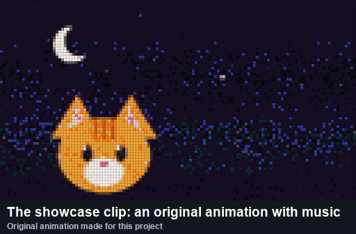
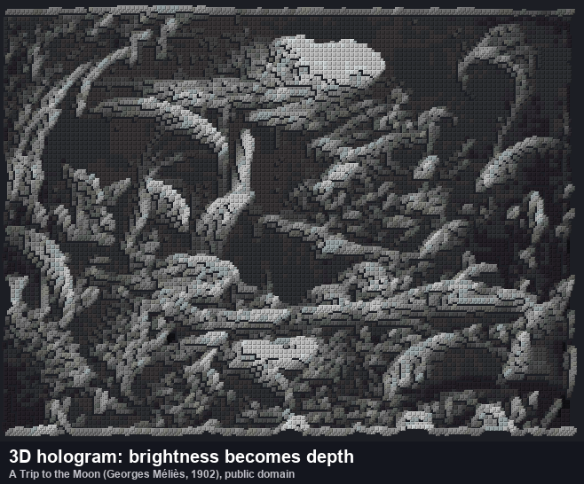
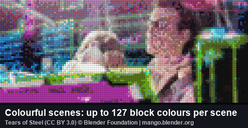

# Block Video Player

**Play your own videos in Minecraft Bedrock — built from real blocks, with synced sound.** Flat screens, walk-around 3D holograms, and a trompe-l'oeil dancer that is repainted for your eye as you move. **No cheats and no experimental toggles needed.** Converting your own video is free and runs in your browser.

This download is the **showcase**: an original animated short, three 3D holograms and a dancing trompe-l'oeil figure.

## ▶ Try the showcase (3 minutes)

1. Open the `.mcaddon` with Minecraft (double-click it).
2. Create a world and turn on **both** the Behavior Pack and the Resource Pack (same name). A superflat world works best. **Cheats can stay off.**
3. Stand on a flat, open spot and type **`/badapple:setup`**, then **`/badapple:start`**.
4. Use a **compass** to open the remote: play, pause, seek, volume and switching videos.

**Needs Minecraft Bedrock 1.26.10 or newer.** On an older Minecraft, use [v6.31.0 from GitHub](https://github.com/ntk758/MinecraftAddon_Bedrock_Video-Player/releases/tag/v6.31.0) (it needs cheats).

**Showcase videos** (switch with `/badapple:play <id>` or *Choose from the list* in the remote; `/badapple:list` shows the IDs):

| ID | What it is |
|---|---|
| `screen` | An original 15-second animated short with music on a 128×72 screen: sunset, fireworks, a rainbow and an orange cat |
| `walk` | A walking silhouette inflated into a rounded 3D figure |
| `waves` | A colourful wave landscape as a 3D relief (brightness = depth) |
| `bounce` | A MagicaVoxel animation of a striped ball bouncing on a floor |
| `dancer` | A trompe-l'oeil dancing girl on a floor and back wall that plays the animated short. She keeps dancing as you walk or fly around |

Where things appear: flat screens start at your feet and spread east and north. 3D holograms stand 2 blocks north of you. The `dancer` stage is about 118 × 51 blocks with an 84-block-high back wall, north of you — watch from in front of it or above the floor. The screen replaces blocks in its way, so pick an empty spot.

## 🎞 Put YOUR video in Minecraft

1. Open the free **[web converter](https://ntk758.github.io/MinecraftAddon_Bedrock_Video-Player/)** on Windows, Mac, Linux or Chromebook. Nothing to install, and **your video never leaves your computer**.
2. Add a video (MP4 etc.), a picture, a clip from your camera, a MagicaVoxel `.vox` or an MMD model with a dance, and press **Create .mcaddon**.
3. **Preview** how it will look in Minecraft right on the page — every frame, next to the original with sound — then open the `.mcaddon` in Minecraft and use it like the showcase.

For bigger screens, faster conversion and the AI person cutout, use the free **Windows app** (below).

## ✨ What makes it different

- **Real blocks, measured colours** — up to 221 real blocks (concrete, terracotta, wool, wood, stone, ores and more), with colours measured from the game's textures. The best 24–127 are picked for each scene.
- **3D holograms you can walk around** — reliefs (brightness as depth), extruded silhouettes, rounded "inflated" shapes and MagicaVoxel animations.
- **Trompe-l'oeil** — the figure is painted onto a floor and back wall exactly as your eye sees it and repainted as you move, so it looks solid from the front, above and the side. A video can play on the back wall. It looks right for one viewer at a time.
- **3D and flat in one add-on** — tick one box to also include the normal flat version of the same video (`<id>_flat`). The sound is stored once, so the add-on barely grows.
- **Synced sound** that follows pause and seek.
- **No cheats, no experimental toggles** — the commands work in normal worlds (operators can use them), and only the stable Script API is used.
- **Plays nicely with your world** — the screen is kept loaded with the add-on's own ticking areas, so it does not use up the world's limit of 10.
- **Small files** — only changed blocks are sent, compressed with an adaptive range coder that also picks the cheapest way to draw each 8×8 area.
- **10 languages** — English, 日本語, 简体中文, 繁體中文, 한국어, Español, Português, Français, Deutsch and Русский. In-game messages and the remote follow each player's game language.

## ⌨ Commands

| Command | What it does |
|---|---|
| `/badapple:setup` | Place the screen where you stand. Add `wall` to stand a flat screen up like a TV facing you, `face` to turn it toward where you look, `align` to shift it (up to 15 blocks) so it covers fewer chunks |
| `/badapple:start` | Play the selected video from the start (to resume after pausing, use the remote) |
| `/badapple:play <id>` | Play a specific video |
| `/badapple:stop` | Stop and clear the screen |
| `/badapple:list` | List the videos and their IDs |
| `/badapple:remote` | Open the remote (same as using a compass) |
| `/badapple:render auto\|rect\|list\|block` | How blocks are placed (`auto` is best) |
| `/badapple:bench` | Measure how fast your device places blocks (`auto` uses the result) |
| `/badapple:stats` | Real fps, server TPS and late frames of the last playback |

The old `/scriptevent badapple:...` commands still work (they need cheats). `badapple` is the showcase's prefix; add-ons you make use the prefix you choose.

## 🖥 Windows app (faster, bigger, smaller add-ons)

- Download `BlockVideoPlayer-…-windows-x64.zip` from the [GitHub releases](https://github.com/ntk758/MinecraftAddon_Bedrock_Video-Player/releases/latest), unzip and run `BlockVideoPlayer.exe` (no Python needed).
- Install FFmpeg with `winget install Gyan.FFmpeg`, or put `ffmpeg.exe` next to the EXE.
- A first-run guide checks your PC, suggests settings for your video and tells you how to play the result.
- Uses NVIDIA, AMD or Intel GPUs when available, and the CPU otherwise.
- **AI person cutout** for dance videos: the dancer becomes a rounded 3D figure (or a trompe-l'oeil dancer, with the rest of the video on the back wall). A separate AI model handles anime and illustrated characters.

## 🧊 3D modes

| Mode | Best for |
|---|---|
| Relief (brightness = depth) | Landscapes, CG, gradients |
| Silhouette (extruded) | Black-and-white videos, shadow-art music videos |
| Inflate (rounded) | Silhouettes and logos |
| Person cutout (AI, Windows app) | Dance videos |
| MagicaVoxel `.vox` | Voxel art and animations (scene graphs and keyframes) |
| MMD (`.pmx` + `.vmd`) | Dancing 3D models |
| + Trompe-l'oeil (option) | Any of the above (figures up to about 64 blocks tall run best) |
| Stained glass palette | See-through holograms (16 colours) |

## 💡 Tips

- Bigger screens look better but cost more performance. Use a PC for 256×256 and up.
- Run `/badapple:bench` once so the add-on learns your device's speed. After playing, `/badapple:stats` shows the real fps — if it is far below the target, use a smaller screen or a lower fps.
- If the game refuses to place some blocks, the add-on says so once in chat with the reason. Please share it in the comments.

## ❓ FAQ

- **Java Edition?** No, Bedrock only.
- **Phones and consoles?** It uses only the stable Script API, so it should work on every Bedrock platform, but so far it has only been tested on PC. Start with a small screen, and please tell us in the comments how it runs on your device.
- **The video IDs don't show up as suggestions after `/badapple:play`.** This seems to be a Minecraft limitation. Use `/badapple:list` to see the IDs.
- **Can I convert videos I don't own?** Only convert videos you have the right to use. The showcase's pictures and music were made from scratch.

## 🎬 Credits for the preview images

- *Tears of Steel* © Blender Foundation (mango.blender.org), [CC BY 3.0](https://creativecommons.org/licenses/by/3.0/), converted to blocks.
- *A Trip to the Moon* (Georges Méliès, 1902), public domain, converted to a 3D relief.
- The cat animation, its music and the dancing girl were made for this project.
- The animated previews are drawn from the block colours outside the game, so lighting and textures look slightly different in-game.

## 🔓 Open source

MIT License. The converter, the in-game player, documentation and benchmarks are on **[GitHub](https://github.com/ntk758/MinecraftAddon_Bedrock_Video-Player)**. Bug reports and ideas are welcome in the comments or on GitHub Issues. Designed and built with help from AI (Claude).
