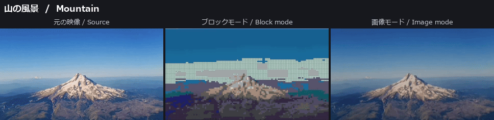
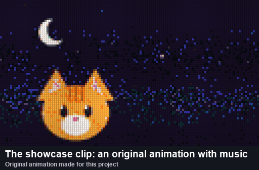
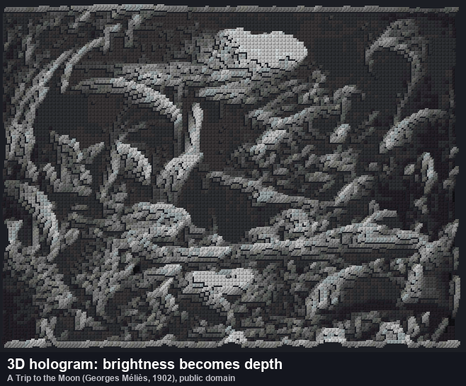
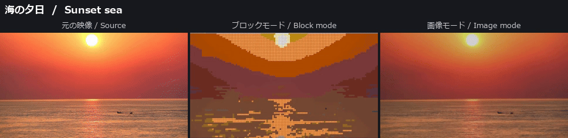
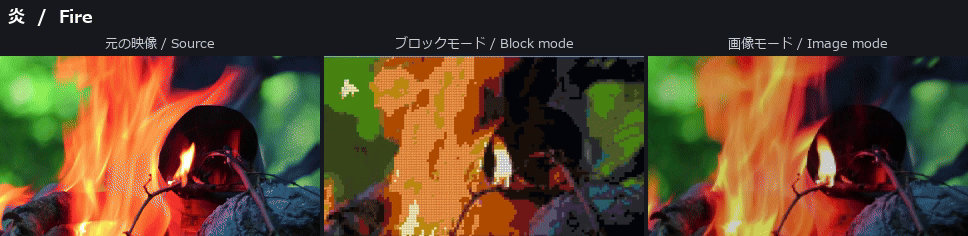
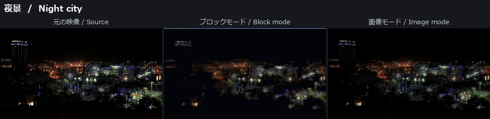
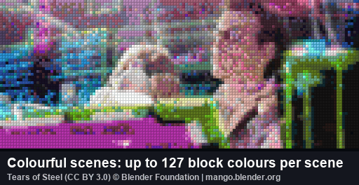

# Block & Image Video Player

**Watch videos in Minecraft Bedrock — made of real blocks, or as smooth 30 fps textures (image mode), with synced sound.** Flat screens, walk-around 3D holograms, and a trompe-l'oeil dancer that is repainted for your eye as you move. **New in v6.41: the Video Screen block** — place it, use it and pick a video; no commands needed, and up to 16 screens can play their own videos. **No cheats and no experimental toggles needed.** Converting your own video is free and runs in your browser.

This download is the **showcase with 5 demo clips** (an original animated short, three 3D holograms and a dancing trompe-l'oeil figure). To play **your own** video, convert it first with the free web converter or Windows app (see below) — it is not an in-game video player for files on your device.

_Recorded in game (Windows 11): the source clip, block mode and image mode side by side._

## ▶ Try the showcase (3 minutes)

1.  Open the `.mcaddon` with Minecraft (on a phone: tap it and choose _Open with Minecraft_; see the install guides on this page).
2.  **Use a new test world** (superflat works best) and turn on **both** the Behavior Pack and the Resource Pack (same name). **Cheats can stay off.** When you join, the add-on prints these steps in the chat.
3.  Stand on flat, open ground, **face where you want the screen**, and type **`/badapple:setup wall`**. The screen stands up in front of you like a TV. **Blocks in that area are replaced.**
4.  Type **`/badapple:start`**.
5.  To pause, seek, change the volume or switch videos, open the remote with **`/badapple:remote`** (or use a compass if you have one).

**Or skip the commands: use a Video Screen block (new in v6.41).**

1.  In the creative inventory, open the _Items_ tab and take a **Video Screen**. Place it on open ground, facing the way you want the screen to face.
2.  Use the block (right-click on PC, long-press on a phone, the _Use_ button on a controller) and choose a video. The screen stands up above the block and starts playing.
3.  Use the block again to pause, stop, seek, switch videos, or change the volume, loop and size (1× to 4× for flat videos). Breaking the block removes its screen.

Up to 16 Video Screens can be placed and 4 can play at the same time, each with its own video, position and volume. **A Video Screen never replaces blocks:** if something is in the way, it doesn't place the screen and tells you where. Tested in game on a Windows 11 PC; phones, consoles and multiplayer sound are not tested yet.

**Needs Minecraft Bedrock 1.26.10 (shown as 26.10 on MCPEDL) or newer.** For 1.21.80 to 1.26.0, make your add-on in the [web converter](https://ntk758.github.io/MinecraftAddon_Bedrock_Video-Player/) with _Minecraft version: 1.21.80 to 1.26.0_, or use [v6.31.0 from GitHub](https://github.com/ntk758/MinecraftAddon_Bedrock_Video-Player/releases/tag/v6.31.0). Both need cheats and use `/scriptevent badapple:setup`.

The commands are for the world's operators (the host in single player). **When other players are in the world** (a Realm, a server or a multiplayer world), the remote (compass or clock) can only be used by operators, and a Video Screen can only be used by the player who placed it and by operators. Playing alone, nothing changes.

**Showcase videos** (switch with `/badapple:play <id>` or _Choose from the list_ in the remote; `/badapple:list` shows the IDs):

| ID                  | What it is                                                                                                                       |
| ------------------- | -------------------------------------------------------------------------------------------------------------------------------- |
| <code>screen</code> | An original 15-second animated short with music on a 128×72 screen: sunset, fireworks, a rainbow and an orange cat               |
| <code>walk</code>   | A walking silhouette inflated into a rounded 3D figure                                                                           |
| <code>waves</code>  | A colourful wave landscape as a 3D relief (brightness = depth)                                                                   |
| <code>bounce</code> | A MagicaVoxel animation of a striped ball bouncing on a floor                                                                    |
| <code>dancer</code> | A trompe-l'oeil dancing girl on a floor and back wall that plays the animated short. She keeps dancing as you walk or fly around |

Where things appear: `setup wall` stands a flat screen up 3 blocks in front of you. Plain `/badapple:setup` lays it flat at your feet (spreading east and north), so look down at it from above. 3D holograms stand 2 blocks north of you. The `dancer` stage is about 118 × 51 blocks with an 84-block-high back wall, north of you — watch from in front of it or above the floor. The screen replaces blocks in its way, so pick an empty spot.

## 🎞 Put YOUR video in Minecraft

1.  Open the free **[web converter](https://ntk758.github.io/MinecraftAddon_Bedrock_Video-Player/)** on Windows, Mac, Linux or Chromebook. Nothing to install, and **your video never leaves your computer**.
2.  Add a video (MP4 etc.), a picture, a clip from your camera, a MagicaVoxel `.vox` or an MMD model with a dance, and press **Create .mcaddon**.
3.  **Preview** how it will look in Minecraft right on the page — every frame, next to the original with sound — then open the `.mcaddon` in Minecraft and use it like the showcase.

For bigger screens, faster conversion and the AI person cutout, use the free **Windows app** (below).

## ✨ What makes it different

*   **Video Screen blocks (new)** — place a block, use it and pick a video. Up to 16 screens, 4 playing at once, each with its own video, volume and loop. A screen never replaces your builds, and sound plays only to players within 48 blocks of it.
*   **Real blocks, measured colours** — up to 221 real blocks (concrete, terracotta, wool, wood, stone, ores and more), with colours measured from the game's textures. The best 24–127 are picked for each scene.
*   **3D holograms you can walk around** — reliefs (brightness as depth), extruded silhouettes, rounded "inflated" shapes and MagicaVoxel animations.
*   **Trompe-l'oeil** — the figure is painted onto a floor and back wall exactly as your eye sees it and repainted as you move, so it looks solid from the front, above and the side. A video can play on the back wall. It looks right for one viewer at a time.
*   **3D and flat in one add-on** — tick one box to also include the normal flat version of the same video (`<id>_flat`). The sound is stored once, so the add-on barely grows.
*   **Synced sound** that follows pause and seek.
*   **No cheats, no experimental toggles** — the commands work in normal worlds (operators can use them), and only the stable Script API is used.
*   **Plays nicely with your world** — the screen is kept loaded with the add-on's own ticking areas, so it does not use up the world's limit of 10.
*   **Small files** — only changed blocks are sent, compressed with an adaptive range coder that also picks the cheapest way to draw each 8×8 area.
*   **10 languages** — English, 日本語, 简体中文, 繁體中文, 한국어, Español, Português, Français, Deutsch and Русский. In-game messages and the remote follow each player's game language.

## ⌨ Commands

| Command                                                | What it does                                                                                                                                                                                                                           |
| ------------------------------------------------------ | -------------------------------------------------------------------------------------------------------------------------------------------------------------------------------------------------------------------------------------- |
| <code>/badapple:setup</code>                           | Place the screen where you stand. Add <code>wall</code> to stand a flat screen up like a TV facing you, <code>face</code> to turn it toward where you look, <code>align</code> to shift it (up to 15 blocks) so it covers fewer chunks |
| <code>/badapple:start</code>                           | Play the selected video from the start (to resume after pausing, use the remote)                                                                                                                                                       |
| <code>/badapple:play &lt;id&gt;</code>                 | Play a specific video                                                                                                                                                                                                                  |
| <code>/badapple:stop</code>                            | Stop and clear the screen                                                                                                                                                                                                              |
| <code>/badapple:list</code>                            | List the videos and their IDs                                                                                                                                                                                                          |
| <code>/badapple:remote</code>                          | Open the remote (same as using a compass)                                                                                                                                                                                              |
| <code>/badapple:render auto\|rect\|list\|block</code>  | How blocks are placed (<code>auto</code> is best)                                                                                                                                                                                      |
| <code>/badapple:bench</code>                           | Measure how fast your device places blocks (<code>auto</code> uses the result)                                                                                                                                                         |
| <code>/badapple:stats</code>                           | Real fps, server TPS and late frames of the last playback                                                                                                                                                                              |

The old `/scriptevent badapple:...` commands still work (they need cheats). `badapple` is the showcase's prefix; add-ons you make use the prefix you choose. The Video Screen block needs no commands at all.

## 🖼 Image mode: smooth video as a texture

The Windows app can also make an **image mode** add-on: instead of placing blocks, the video plays as a texture on a thin panel, so it is smooth (up to 30 fps) and sharp (up to 512×288 pixels). The picture keeps its brightness at night and in dark places, and the sound stays in time even when the server slows down.

*   Same controls as block mode: `/<prefix>:setup` with `wall`, `face` and `align`, `start`, `play <id>`, `volume`, `seek`, `stats`, and a remote you open with a **clock** (block mode keeps the compass, so both can be installed together).
*   Long videos don't fit in the game's texture memory. When converting, choose what to keep: **picture quality** (lower fps), **smoothness** (smaller picture) or **length**, and whether it should also run on phones and consoles.
*   Put block mode and image mode in **one `.mcaddon`**, or make them separately.
*   Not real blocks: you can't walk through or build on the picture, and there are no 3D modes yet. Video Screen blocks don't play image mode videos yet. Tested in game on PC (Windows 11).

|                      | Block mode             | Image mode                |
| -------------------- | ---------------------- | ------------------------- |
| Looks like           | Real blocks            | A sharp, smooth picture   |
| fps                  | Depends on your device | Up to 30                  |
| Long videos          | Fine                   | Limited by texture memory |
| 3D and trompe-l'oeil | Yes                    | Not yet                   |
| Video Screen block   | Yes                    | Not yet                   |

## 🖥 Windows app (faster, bigger, smaller add-ons)

*   Download `BlockVideoPlayer-…-windows-x64.zip` from the [GitHub releases](https://github.com/ntk758/MinecraftAddon_Bedrock_Video-Player/releases/latest), unzip and run `BlockVideoPlayer.exe` (no Python needed).
*   **Use v6.41.1 or later.** The v6.41.0 Windows app cannot build any add-on (fixed in v6.41.1). If you are stuck on v6.41.0, use the web converter.
*   Install FFmpeg with `winget install Gyan.FFmpeg`, or put `ffmpeg.exe` next to the EXE.
*   A first-run guide checks your PC, suggests settings for your video and tells you how to play the result.
*   Uses NVIDIA, AMD or Intel GPUs when available, and the CPU otherwise.
*   **AI person cutout** for dance videos: the dancer becomes a rounded 3D figure (or a trompe-l'oeil dancer, with the rest of the video on the back wall). A separate AI model handles anime and illustrated characters.

## 🧊 3D modes

| Mode                                        | Best for                                                       |
| ------------------------------------------- | -------------------------------------------------------------- |
| Relief (brightness = depth)                 | Landscapes, CG, gradients                                      |
| Silhouette (extruded)                       | Black-and-white videos, shadow-art music videos                |
| Inflate (rounded)                           | Silhouettes and logos                                          |
| Person cutout (AI, Windows app)             | Dance videos                                                   |
| MagicaVoxel <code>.vox</code>               | Voxel art and animations (scene graphs and keyframes)          |
| MMD (<code>.pmx</code> + <code>.vmd</code>) | Dancing 3D models                                              |
| + Trompe-l'oeil (option)                    | Any of the above (figures up to about 64 blocks tall run best) |
| Stained glass palette                       | See-through holograms (16 colours)                             |

## 💡 Tips

*   Bigger screens look better but cost more performance. Use a PC for 256×256 and up.
*   Run `/badapple:bench` once so the add-on learns your device's speed. After playing, `/badapple:stats` shows the real fps — if it is far below the target, use a smaller screen or a lower fps.
*   If the game refuses to place some blocks, the add-on says so once in chat with the reason. Please share it in the comments.
*   Two Video Screens close to each other: players near both hear both sounds (there is no fade with distance yet). Set one screen's volume to 0.

## ❓ FAQ

*   **Java Edition?** No, Bedrock only.
*   **Phones and consoles?** It uses only the stable Script API, so it should work on every Bedrock platform, but so far it has only been tested on PC. Start with a small screen, and please tell us in the comments how it runs on your device.
*   **The video IDs don't show up as suggestions after `/badapple:play`.** This seems to be a Minecraft limitation. Use `/badapple:list` to see the IDs.
*   **"You can't use this" on a server?** With other players in the world, the remote is for operators only, and a Video Screen is for the player who placed it and operators. Ask an operator, or play in your own world.
*   **Where is the Video Screen?** In the creative inventory's _Items_ tab. It is a block-mode feature; the showcase and add-ons made with v6.41.0 or later have it.
*   **Can I convert videos I don't own?** Only convert videos you have the right to use. The showcase's pictures and music were made from scratch.

## 🎬 Credits for the preview images

*   The three-panel GIFs (mountain, sunset sea, fire, night city) are real in-game recordings on Windows 11. The footage is CC0 from Wikimedia Commons: Mt Hood Aerial View (Pastelitodepapa), Ocean surface waves 06 and Fire 10 (Mostafameraji), Raindrops against the window in the night city, Las Palmas (slavikfi). Full list: [CREDITS.md](https://github.com/ntk758/MinecraftAddon_Bedrock_Video-Player/blob/main/docs/images/genres/CREDITS.md).
*   _Tears of Steel_ © Blender Foundation (mango.blender.org), [CC BY 3.0](https://creativecommons.org/licenses/by/3.0/), converted to blocks.
*   _A Trip to the Moon_ (Georges Méliès, 1902), public domain, converted to a 3D relief.
*   The cat animation, its music and the dancing girl were made for this project.
*   The cat, moon and neon city previews are drawn from the block colours outside the game, so lighting and textures look slightly different in-game.

## 🔓 Open source

MIT License. The converter, the in-game player, documentation and benchmarks are on **[GitHub](https://github.com/ntk758/MinecraftAddon_Bedrock_Video-Player)**. Bug reports and ideas are welcome in the comments or on GitHub Issues. Designed and built with help from AI
